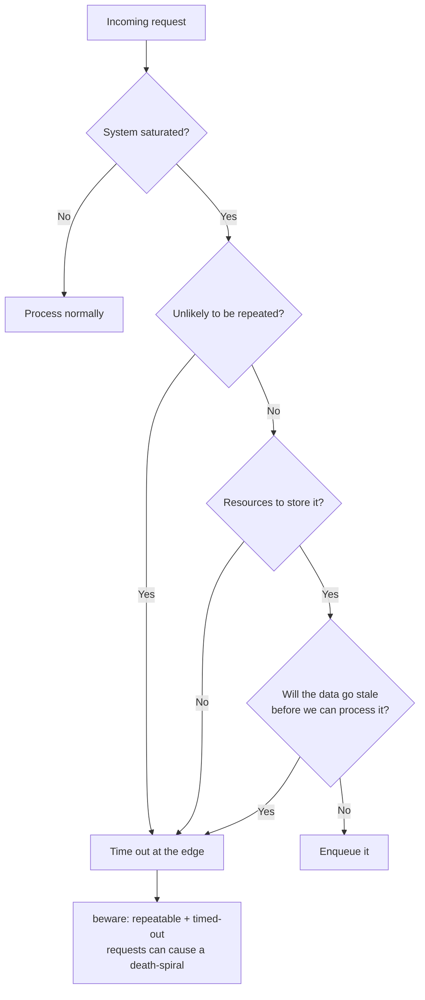
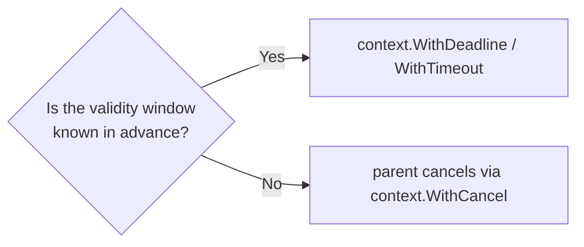
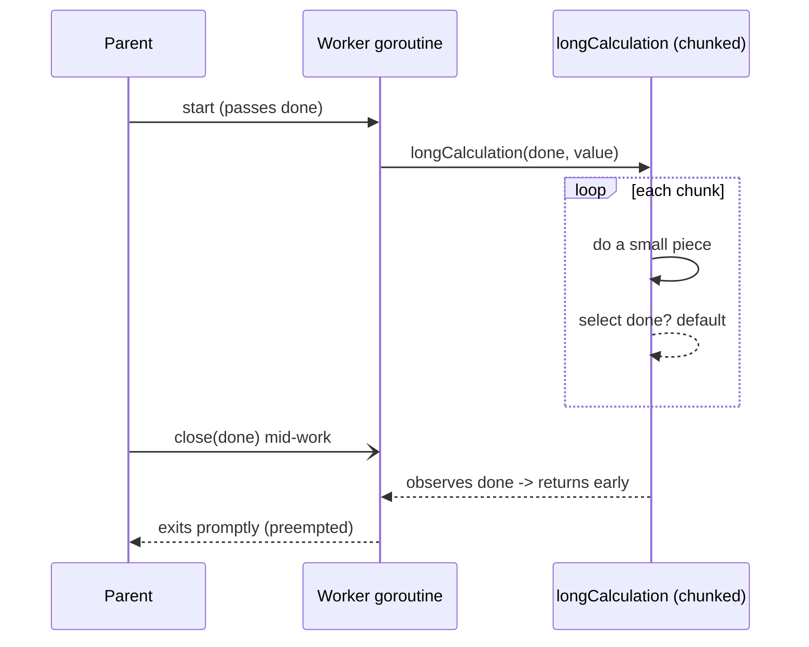
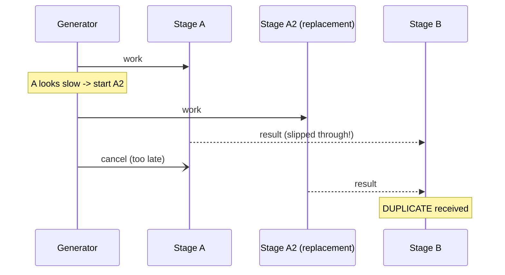
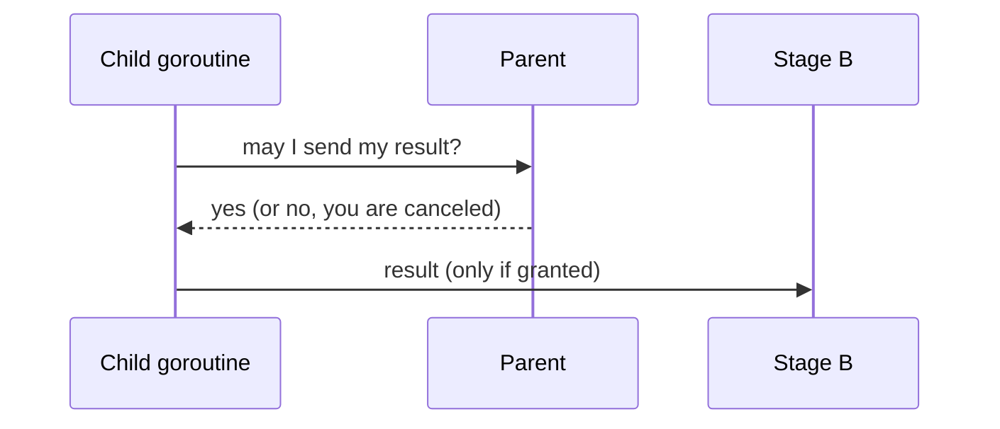

# Ch 5.2 — Timeouts and Cancellation

> Book: *Concurrency in Go* (Katherine Cox-Buday, O'Reilly 2017) · Chapter 5: Concurrency at Scale · Pages ~155–161
> ⬅️ Prev: [Error Propagation](01-error-propagation.md) · ➡️ Next: [Heartbeats](03-heartbeats.md) · 🏠 [Book index](README.md)

## 🎯 In One Paragraph

Timeouts and cancellation show up everywhere in concurrent systems, and designing for them from the start is far easier than bolting them on later ("like trying to add eggs to a cake after it has been baked"). You want timeouts for three reasons: **system saturation** (shed load at the edges rather than queue forever), **stale data** (data with an expiry window — use `context.WithDeadline`/`WithTimeout` if the window is known, `context.WithCancel` if not), and **deadlock prevention** (put a generous timeout on every concurrent op so a deadlocked system self-unblocks — accepting that you may convert a deadlock into a livelock, which is the lesser evil). Cancellation itself has several causes: timeouts (an implicit cancel), user intervention, parent cancellation, and replicated requests. The hard part is not *why* but *how*: a goroutine must be **preemptable** — you must define the window within which it can be stopped and make every operation longer than that window itself preemptable (recursively threading `done` down the call stack). You must also handle **shared-state rollback** (keep mutations in a tight scope / build results in memory and write once) and **duplicate messages** (prefer heartbeats/bidirectional signalling so a parent almost never cancels after a child already produced a result).

## 🧠 Key Concepts & Vocabulary

- **Timeout**: A bound on how long a concurrent operation may take before it is abandoned. A timeout is an **implicit cancellation**.
- **Cancellation**: Stopping an in-flight concurrent process. Implemented with a `done` channel or `context.Context` (from Chapter 4).
- **Three reasons to time out**:
  - **System saturation** — when at capacity, time out requests at the edges if (a) the request is unlikely to be repeated, (b) you lack resources to store it, or (c) its data will go stale. Repeatable requests risk a **death-spiral** where timeout overhead exceeds capacity.
  - **Stale data** — data valid only within a window. Known window → `context.WithDeadline`/`WithTimeout`. Unknown window → let the parent cancel via `context.WithCancel`.
  - **Deadlock prevention** — put timeouts on all concurrent ops so a deadlocked system unblocks. The period only needs to be short enough to recover "reasonably", not close to the real operation time.
- **Deadlock → livelock trade**: A timeout can turn a deadlock into a livelock. In large systems the timing profile shifts, so a livelock you can fix later beats a deadlock recoverable only by restart. Goal: converge on a system where the timeouts never fire.
- **Causes of cancellation**: timeout, user intervention (long-running ops should report status + allow cancel), parent cancellation (a child dies with its parent), and replicated requests (cancel the losers once one wins).
- **Preemptability**: The property that a goroutine can be stopped promptly. Define the acceptable preemption window; ensure every atomic operation is shorter than it, or make long operations preemptable by threading `done` into them.
- **Shared-state rollback**: On cancellation mid-write, you may need to undo partial state. Minimize the surface by building results in memory and writing state as few times as possible (ideally once).
- **Duplicate messages**: If a replacement goroutine (A2) is started while A is still alive, downstream B may receive two results. Mitigations: make late cancellation vanishingly unlikely (heartbeats), accept first/last result (if idempotent), or poll the parent for permission to send.

## 📚 Deep Dive

### When to time out



Picking the mechanism for stale data:



### Preemptability: the core problem

Take a goroutine that reads a value, does a long computation, then writes a result, guarding the channel operations with `done`:

```go
var value any
select {
case <-done:
    return
case value = <-valueStream:
}

result := reallyLongCalculation(value) // <-- NOT preemptable!

select {
case <-done:
    return
case resultStream <- result:
}
```

The channel ops are preemptable, but `reallyLongCalculation` is not: a cancellation during it waits until it finishes. First attempt — make it preemptable *between* sub-calls:

```go
reallyLongCalculation := func(done <-chan any, value any) any {
    intermediate := longCalculation(value)
    select {
    case <-done:
        return nil
    default:
    }
    return longCalculation(intermediate)
}
```

That only halves the problem — we can preempt only *between* the two long calls. The logical conclusion: thread `done` all the way down so each long call is itself preemptable.

```go
reallyLongCalculation := func(done <-chan any, value any) any {
    intermediate := longCalculation(done, value)
    return longCalculation(done, intermediate)
}
```

> **Rule:** Define the period within which your process is preemptable, and ensure every operation longer than that period is itself preemptable. Break goroutines into small pieces; all nonpreemptable atomic operations should complete in less than your acceptable window.



Verified, self-contained preemptability demo (cancels mid-calculation; the worker exits cleanly):

```go
package main

import (
    "fmt"
    "time"
)

func longCalculation(done <-chan any, value int) int {
    result := value
    for i := 0; i < 5; i++ {
        select {
        case <-done:
            return -1 // canceled
        default:
        }
        time.Sleep(50 * time.Millisecond)
        result += i
    }
    return result
}

func reallyLongCalculation(done <-chan any, value int) int {
    intermediate := longCalculation(done, value)
    if intermediate < 0 {
        return -1
    }
    return longCalculation(done, intermediate)
}

func main() {
    done := make(chan any)
    valueStream := make(chan int, 1)
    resultStream := make(chan int, 1)
    valueStream <- 10

    go func() {
        var value int
        select {
        case <-done:
            return
        case value = <-valueStream:
        }
        result := reallyLongCalculation(done, value)
        select {
        case <-done:
            return
        case resultStream <- result:
        }
    }()

    time.AfterFunc(120*time.Millisecond, func() { close(done) }) // cancel mid-calc

    select {
    case r := <-resultStream:
        fmt.Printf("result: %d\n", r)
    case <-time.After(2 * time.Second):
        fmt.Println("gave up waiting")
    }
    time.Sleep(50 * time.Millisecond)
    fmt.Println("done; goroutine preempted cleanly")
}
```

**Verified output:** `gave up waiting` then `done; goroutine preempted cleanly` — the worker observed `done` between chunks and never sent a result.

### Shared-state rollback: shrink the surface

If a goroutine mutates shared state (DB, file, in-memory structure) and is canceled, you may need to roll back. The wrong way writes state repeatedly:

```go
result := add(1, 2, 3)
writeTallyToState(result)         // write 1
result = add(result, 4, 5, 6)
writeTallyToState(result)         // write 2
result = add(result, 7, 8, 9)
writeTallyToState(result)         // write 3  <- cancel here = roll back 1 & 2
```

The better way accumulates in memory and writes once, shrinking the rollback surface:

```go
result := add(1, 2, 3, 4, 5, 6, 7, 8, 9)
writeTallyToState(result)         // single write
```

Verified version using `context.WithTimeout` for the single commit:

```go
package main

import (
    "context"
    "fmt"
    "time"
)

func add(values ...int) int {
    sum := 0
    for _, v := range values {
        sum += v
    }
    return sum
}

func writeTallyToState(ctx context.Context, result int) error {
    select {
    case <-ctx.Done():
        return ctx.Err()
    case <-time.After(10 * time.Millisecond):
        fmt.Printf("state written once: %d\n", result)
        return nil
    }
}

func main() {
    ctx, cancel := context.WithTimeout(context.Background(), 500*time.Millisecond)
    defer cancel()

    result := add(1, 2, 3, 4, 5, 6, 7, 8, 9) // accumulate in memory
    if err := writeTallyToState(ctx, result); err != nil {
        fmt.Println("canceled before commit, nothing to roll back:", err)
        return
    }
    fmt.Println("committed cleanly, result =", result)

    ctx2, cancel2 := context.WithTimeout(context.Background(), 5*time.Millisecond)
    defer cancel2()
    if err := writeTallyToState(ctx2, 42); err != nil {
        fmt.Println("second op timed out as expected:", err)
    }
}
```

**Verified output:**

```text
state written once: 45
committed cleanly, result = 45
second op timed out as expected: context deadline exceeded
```

### Duplicate messages

Consider a pipeline `generator → A → B`. The generator watches A's responsiveness and starts a replacement **A2** if A goes slow. If the cancel to A arrives *after* A already sent its result to B, B gets a duplicate (Figure 5-1 in the book).



Ways to avoid duplicates, in the author's order of preference:

1. **Make late cancellation vanishingly unlikely (recommended)** — bidirectional communication so the parent knows the child's state; covered next in **Heartbeats**.
2. **Accept first or last result** — fine if the stage is idempotent or the algorithm tolerates it.
3. **Poll the parent for permission before sending** (Figure 5-2) — the safest but most complex; rarely needed, so prefer heartbeats.



## ⚠️ Pitfalls & Gotchas

- **Non-preemptable hot spots.** A single long function with no `done` check pins your cancellation latency to its full runtime. Thread `done`/`ctx` all the way down.
- **Treating a timeout as safe cleanup.** Cancelling a context does **not** stop a goroutine; it only *signals*. The goroutine must observe `ctx.Done()` and return.
- **Death-spiral from timing out repeatable requests.** If clients retry, timeout overhead can exceed capacity. Only time out at the edge when the request won't be usefully retried or stored.
- **Large rollback surface.** Writing shared state repeatedly multiplies what you must undo on cancel. Build in memory, write once.
- **Duplicate downstream messages.** A replacement goroutine plus a late cancel = duplicates. Use heartbeats / idempotency / permission-polling.
- **Deadlock-avoidance timeouts that are too tight.** A tight timeout on a healthy op can itself cause spurious failures or livelock; size it to "recover reasonably", and aim for it never to fire.

## 🆕 Modern Go Notes

> [!note] 🆕 Prefer `context.Context` over bare `done` channels
> The book teaches both `done` channels and `context`. In modern Go, `context` is the idiomatic cancellation carrier threaded through call chains.
> - `context.WithTimeout` / `context.WithDeadline` for known windows; `context.WithCancel` for parent-controlled cancellation.
> - **Go 1.20**: `context.WithCancelCause(parent)` lets you cancel *with a reason*; `context.Cause(ctx)` retrieves it — great for distinguishing "timed out" from "user canceled".
> - **Go 1.21**: `context.AfterFunc(ctx, f)` runs `f` in its own goroutine when `ctx` is done — a clean way to attach cleanup/rollback.
> - **Go 1.22**: loop variables are per-iteration, so capturing the loop variable in `go func(){...}()` is no longer a classic bug (relevant when launching per-item cancellable workers).
> - **Goroutine preemption (Go 1.14+)**: the runtime added *asynchronous* preemption, so a tight CPU loop can be preempted by the *scheduler*. This is about fair scheduling/GC, **not** your cancellation logic — you still must check `done`/`ctx` to stop your own work.

## 🧪 Try It Yourself

1. Convert the preemptability demo to use `context.Context`; cancel with `context.WithCancelCause` and print `context.Cause(ctx)` from inside the worker.
2. Instrument `longCalculation` to count how many chunks ran before cancellation; verify a smaller chunk size yields lower cancellation latency.
3. Build the `generator → A → B` pipeline and deliberately trigger a duplicate at B; then add a per-unit heartbeat (next section) and show the duplicate disappears.
4. Measure the rollback cost difference: simulate a crash after each `writeTallyToState` in the "wrong" version vs. the single-write version.

## ✅ Self-Check Questions

<details><summary>What are the three reasons to add a timeout to a concurrent operation?</summary>
System saturation (shed load at the edges), stale data (process within its validity window), and deadlock prevention (ensure a stuck system self-unblocks).
</details>

<details><summary>Which context constructor fits a known validity window vs. an unknown one?</summary>
Known window → `context.WithDeadline` or `context.WithTimeout`. Unknown window → let the parent cancel via `context.WithCancel`.
</details>

<details><summary>What does it mean for a goroutine to be "preemptable", and how do you achieve it for long work?</summary>
It can be stopped promptly on cancellation. You define an acceptable preemption window and ensure every operation longer than it is itself preemptable — by threading the `done`/`ctx` signal down the call stack and breaking work into small, individually checkable chunks.
</details>

<details><summary>Why can adding a timeout turn a deadlock into a livelock, and why is that acceptable?</summary>
A timeout unblocks the stuck operation, which may retry and re-collide, producing a livelock. It's acceptable because a livelock can be fixed later while the system stays reachable, whereas a deadlock may require a restart to recover.
</details>

<details><summary>How do you minimize the rollback surface for cancellable, state-mutating work?</summary>
Keep state mutations in a tight scope — build intermediate results in memory and write to shared state as few times as possible (ideally once), so a cancel leaves little or nothing to undo.
</details>

<details><summary>What is the author's preferred way to avoid duplicate downstream messages, and what are the alternatives?</summary>
Preferred: make late cancellation vanishingly unlikely via bidirectional heartbeats. Alternatives: accept the first/last result (if idempotent), or poll the parent for explicit permission before sending (safest but most complex).
</details>

<details><summary>Does cancelling a context stop a running goroutine?</summary>
No. It only delivers a signal via `ctx.Done()`. The goroutine must observe that signal and return on its own; nothing stops it "from the outside".
</details>

## 🔑 Key Takeaways

- Design timeouts and cancellation in from the start — retrofitting is painful.
- Timeouts serve saturation, stale-data, and deadlock-prevention goals; a timeout is an implicit cancellation.
- Make goroutines **preemptable**: define the window, thread `done`/`ctx` down the stack, break long work into checkable chunks.
- Minimize **shared-state rollback** surface — accumulate in memory, write once.
- Avoid **duplicate messages**; prefer heartbeats (next section) over permission-polling.
- Prefer `context` in modern Go; `WithCancelCause`/`Cause`, `AfterFunc` add reason-tracking and cleanup.

## 🔗 References & Further Reading

📝 Blogs/articles:
- [Go Concurrency Patterns: Pipelines and cancellation — go.dev/blog](https://go.dev/blog/pipelines) — the canonical treatment of `done`-channel cancellation and avoiding goroutine leaks in pipelines.
- [Go Concurrency Patterns: Context — go.dev/blog](https://go.dev/blog/context) — Sameer Ajmani's introduction to request-scoped cancellation, deadlines, and values.
- [Context Package Semantics in Go — Ardan Labs (Bill Kennedy)](https://www.ardanlabs.com/blog/2019/09/context-package-semantics-in-go.html) — deep dive on timeout/cancel semantics and common pitfalls.
- [How to Gracefully Cancel Long-Running Goroutines with Context — oneuptime](https://oneuptime.com/blog/post/2026-01-25-gracefully-cancel-goroutines-context-go/view) — practical preemptability and cleanup patterns.

💻 GitHub:
- [kat-co/concurrency-in-go-src](https://github.com/kat-co/concurrency-in-go-src) — the book's official source for the preemptability and rollback examples.
- [janos/singleflight](https://github.com/janos/singleflight) — duplicate-call suppression with context cancellation, a real-world take on avoiding duplicate work.

📖 Official docs/specs:
- [context package — pkg.go.dev](https://pkg.go.dev/context) — `WithCancel`, `WithTimeout`, `WithDeadline`, `WithCancelCause`, `Cause`, `AfterFunc`.
- [Canceling in-progress operations — go.dev](https://go.dev/doc/database/cancel-operations) — applying context timeouts/deadlines to real I/O.
- [Go 1.20 release notes — context.WithCancelCause](https://go.dev/doc/go1.20#context) — cancellation with a cause.
