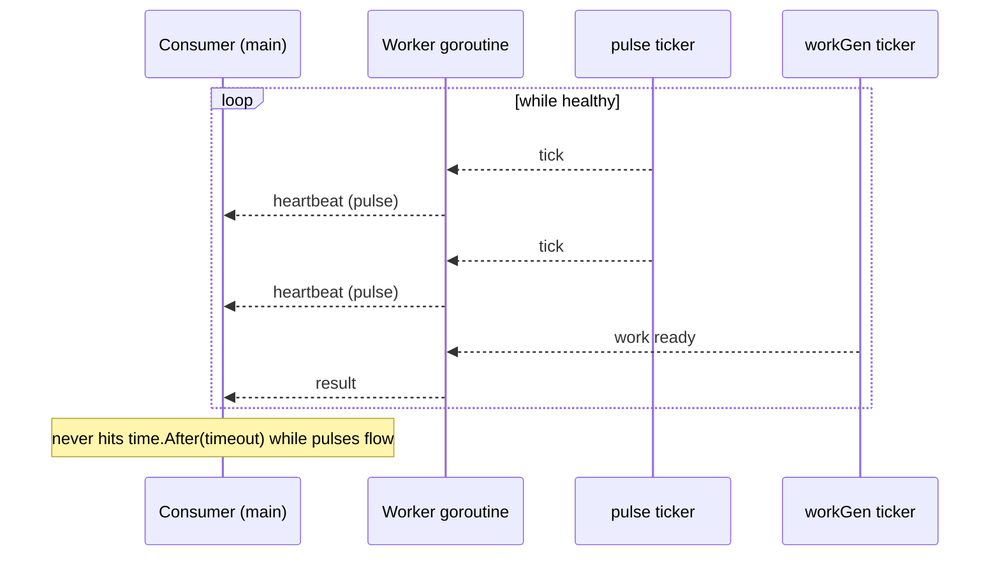
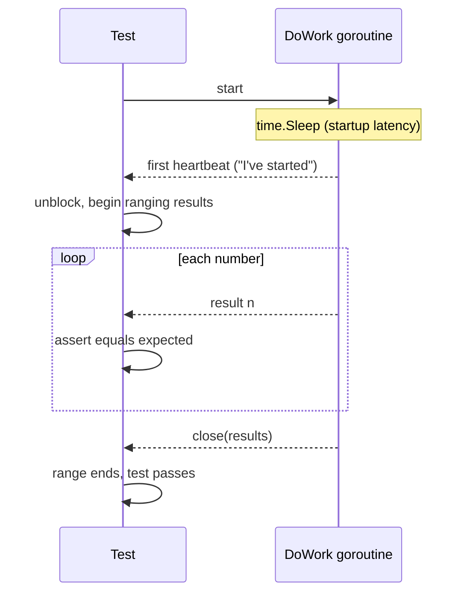

# Ch 5.3 — Heartbeats

> Book: *Concurrency in Go* (Katherine Cox-Buday, O'Reilly 2017) · Chapter 5: Concurrency at Scale · Pages ~161–172
> ⬅️ Prev: [Timeouts and Cancellation](02-timeouts-and-cancellation.md) · ➡️ Next: [Replicated Requests](04-replicated-requests.md) · 🏠 [Book index](README.md)

## 🎯 In One Paragraph

A **heartbeat** is how a concurrent process signals "I'm alive" to an observer — the name comes from the way a human heartbeat signifies life. Heartbeats give us two superpowers: **insight** into a live system, and **determinism** in tests that would otherwise be flaky. There are two flavours. **Interval-based heartbeats** pulse on a timer and are ideal for a goroutine that spends long periods waiting for work — the pulse tells listeners "silence is expected, nothing is wrong." If the goroutine panics or hangs, the pulses stop, and a listener using a timeout (coupled as `timeout/2` so it isn't too sensitive) detects the problem within one timeout window — avoiding a deadlock while staying deterministic. **Per-unit-of-work heartbeats** pulse once at the start of every work item; they're perfect for tests, because the test can block on the first heartbeat (proving the goroutine actually started) and then simply `range` over results — eliminating the arbitrary timeouts that make concurrent tests nondeterministic. The key safety idiom in both is a `select` with a `default` on the heartbeat send (nobody may be listening — results are critical, pulses are not) and, for per-unit heartbeats, a channel **buffered by one** so an early pulse survives a listener that isn't ready yet.

## 🧠 Key Concepts & Vocabulary

- **Heartbeat**: A signal a concurrent process emits to prove liveness to an outside party.
- **Interval-based heartbeat**: Pulses on a time interval. Useful when a goroutine waits an unknown time for incoming work; silence between results is expected, so the pulse reassures listeners.
- **Per-unit-of-work heartbeat**: Pulses once at the beginning of each work item. Simple and ideal for tests where you only care that the goroutine has *started working*.
- **`sendPulse` with `default`**: A non-blocking heartbeat send — `select { case heartbeat <- struct{}{}: default: }`. Guards against the fact that nobody may be listening. Results matter; pulses don't.
- **Coupling timeout to interval (`timeout/2`)**: The consumer's timeout should be larger than the heartbeat interval so a single late pulse doesn't trip a false alarm. The book passes `timeout/2` as the pulse interval, giving the heartbeat "an extra tick to respond."
- **Buffered-by-one heartbeat channel**: For per-unit heartbeats, `make(chan any, 1)` ensures at least one pulse is retained even if the listener isn't ready for the first send.
- **Determinism in tests**: Blocking on the first heartbeat replaces an arbitrary "sleep/timeout and hope" with "wait for the actual event," removing flakiness.
- **For-select-in-for**: Because multiple pulses may be sent while waiting to read input or send a result, each `select` lives inside its own `for` loop.

## 📚 Deep Dive

### Interval-based heartbeat — the healthy case

`doWork` returns two channels: a `heartbeat` and a `results` stream. It pulses every `pulseInterval`; "work" arrives at `2*pulseInterval` so we see ~2 pulses per result. Every send/receive in the worker also has a `case <-pulse` so pulses keep flowing even while blocked.

```go
package main

import (
    "fmt"
    "time"
)

func doWork(done <-chan any, pulseInterval time.Duration) (<-chan any, <-chan time.Time) {
    heartbeat := make(chan any)
    results := make(chan time.Time)
    go func() {
        defer close(heartbeat)
        defer close(results)

        pulse := time.Tick(pulseInterval)
        workGen := time.Tick(2 * pulseInterval) // simulate incoming work

        sendPulse := func() {
            select {
            case heartbeat <- struct{}{}:
            default: // nobody listening -> fine, pulses are not critical
            }
        }
        sendResult := func(r time.Time) {
            for { // may pulse several times while waiting to send a result
                select {
                case <-done:
                    return
                case <-pulse:
                    sendPulse()
                case results <- r:
                    return
                }
            }
        }

        for {
            select {
            case <-done:
                return
            case <-pulse:
                sendPulse()
            case r := <-workGen:
                sendResult(r)
            }
        }
    }()
    return heartbeat, results
}

func main() {
    done := make(chan any)
    time.AfterFunc(10*time.Second, func() { close(done) })

    const timeout = 2 * time.Second
    heartbeat, results := doWork(done, timeout/2) // couple interval to timeout
    for {
        select {
        case _, ok := <-heartbeat:
            if !ok {
                return
            }
            fmt.Println("pulse")
        case r, ok := <-results:
            if !ok {
                return
            }
            fmt.Printf("results %v\n", r.Second())
        case <-time.After(timeout):
            fmt.Println("worker goroutine is not healthy!")
            return
        }
    }
}
```

**Verified output** (trimmed) — about two pulses per result, exactly as intended:

```text
pulse
pulse
results 9
pulse
pulse
results 11
pulse
pulse
```



### Interval-based heartbeat — catching a broken goroutine

Now simulate a panic by looping only twice and **not** closing the channels (no `defer close`). The worker goes silent; the consumer's `time.After(timeout)` fires.

```go
// worker body changed to:
for i := 0; i < 2; i++ { // simulated panic: stop after 2 iterations
    select {
    case <-done:
        return
    case <-pulse:
        sendPulse()
    case r := <-workGen:
        sendResult(r)
    }
}
// NOTE: channels are NOT closed -> consumer must rely on its timeout
```

**Book output:**

```text
pulse
pulse
worker goroutine is not healthy!
```



```mermaid
stateDiagram-v2
    [*] --> Healthy
    Healthy --> Healthy: pulse received (continue)
    Healthy --> Dead: no pulse within timeout
    Dead --> [*]: "print not healthy; break loop"
```

Within one timeout window the consumer detects the fault, avoids a deadlock, and stays deterministic (no need for a long speculative timeout). This is the seed of **Healing Unhealthy Goroutines** (section 5.7).

> [!tip] Heartbeats also cover the opposite case
> They tell you a long-running goroutine is *still up but just slow* to produce a value — not dead — so you don't kill a healthy-but-busy worker.

### Per-unit-of-work heartbeat

Pulse once before each work item. The heartbeat channel is **buffered by one** so an early pulse isn't lost; the heartbeat `select` is **separate** from the result `select` (otherwise a not-yet-ready receiver would get a pulse and the result value would be lost).

```go
package main

import (
    "fmt"
    "math/rand"
)

func doWork(done <-chan any) (<-chan any, <-chan int) {
    heartbeatStream := make(chan any, 1) // buffer 1: pulse survives a slow listener
    workStream := make(chan int)
    go func() {
        defer close(heartbeatStream)
        defer close(workStream)

        for i := 0; i < 10; i++ {
            select { // separate, non-blocking heartbeat
            case heartbeatStream <- struct{}{}:
            default:
            }
            select {
            case <-done:
                return
            case workStream <- rand.Intn(10):
            }
        }
    }()
    return heartbeatStream, workStream
}
```

**Verified output** (trimmed) — one pulse per result:

```text
pulse
results 0
pulse
results 5
pulse
results 5
...
```

### Heartbeats make tests deterministic

A **bad** test picks an arbitrary timeout and hopes the goroutine starts in time. With a startup `time.Sleep` it fails; without it, it passes *sometimes* — the worst kind of flaky.

```go
func TestDoWork_GeneratesAllNumbers(t *testing.T) { // BAD: nondeterministic
    done := make(chan any)
    defer close(done)
    intSlice := []int{0, 1, 2, 3, 5}
    _, results := DoWork(done, intSlice...)
    for i, expected := range intSlice {
        select {
        case r := <-results:
            if r != expected {
                t.Errorf("index %v: expected %v, but received %v", i, expected, r)
            }
        case <-time.After(1 * time.Second): // arbitrary!
            t.Fatal("test timed out")
        }
    }
}
```

The **good** test blocks on the first heartbeat (proving the goroutine entered its loop) then simply ranges — no timeouts, fully deterministic:

```go
func TestDoWork_GeneratesAllNumbers(t *testing.T) { // GOOD: deterministic
    done := make(chan any)
    defer close(done)
    intSlice := []int{0, 1, 2, 3, 5}
    heartbeat, results := DoWork(done, intSlice...)

    <-heartbeat // wait for the goroutine to signal it started

    i := 0
    for r := range results {
        if expected := intSlice[i]; r != expected {
            t.Errorf("index %v: expected %v, but received %v", i, expected, r)
        }
        i++
    }
}
```

Here `DoWork` has a deliberate `time.Sleep(2*time.Second)` to model nondeterministic startup latency (CPU load, disk contention, network latency, "and goblins"). **Verified** with `go test`:

```text
=== RUN   TestDoWork_GeneratesAllNumbers
--- PASS: TestDoWork_GeneratesAllNumbers (2.00s)
PASS
ok      cig5scratch/hbtest      2.004s
```

The test waits for the *event* (first heartbeat), so the 2-second startup no longer causes a flake — it just makes the test take ~2s.



### Interval-based heartbeats inside tests (maximal safety)

If you also want to guard against a single iteration hanging, you can combine: block on the first heartbeat, then in the result loop also `select` on `<-heartbeat` (to keep the timeout from firing while work is healthy) and on `<-time.After(timeout)`. The worker uses a labelled inner loop (`numLoop`) to retry sending each number while pulsing:

```go
func DoWork(done <-chan any, pulseInterval time.Duration, nums ...int) (<-chan any, <-chan int) {
    heartbeat := make(chan any, 1)
    intStream := make(chan int)
    go func() {
        defer close(heartbeat)
        defer close(intStream)
        time.Sleep(2 * time.Second)
        pulse := time.Tick(pulseInterval)
    numLoop:
        for _, n := range nums {
            for {
                select {
                case <-done:
                    return
                case <-pulse:
                    select {
                    case heartbeat <- struct{}{}:
                    default:
                    }
                case intStream <- n:
                    continue numLoop
                }
            }
        }
    }()
    return heartbeat, intStream
}
```

The test selects on results, on `<-heartbeat` (to stay alive), and on `<-time.After(timeout)` (to fail a truly stuck iteration). The book notes this version is **much less clear**, so unless you specifically need per-iteration timeout protection, prefer "block on first heartbeat, then range," and write *separate* tests for channel-closing and slow-iteration concerns.

## ⚠️ Pitfalls & Gotchas

- **Blocking heartbeat sends.** Always use `select { case heartbeat <- ...: default: }`. A blocking send couples your worker's liveness to a listener that may be gone — results are critical, pulses are not.
- **Unbuffered per-unit heartbeat.** Without a buffer of 1, an early pulse can be lost if the listener isn't ready; the test may then block forever on `<-heartbeat`.
- **Merging heartbeat and result into one `select`.** A not-yet-ready receiver may consume a pulse and lose the result value. Keep them in separate `select` blocks for per-unit heartbeats.
- **Timeout too close to interval.** If the consumer timeout ≈ pulse interval, one slightly late pulse trips a false "unhealthy." Use `timeout/2` as the interval (an extra tick of slack).
- **Forgetting `case <-pulse` on blocking ops.** Any send/receive that can block must also have a pulse case inside a `for` loop, or heartbeats stall while the worker waits.
- **Arbitrary timeouts in tests.** They make tests flaky and erode trust in the suite. Wait on events (heartbeats), not wall-clock durations.
- **Not closing channels on exit.** A worker that returns without closing its channels looks "hung" to a `range`; that's exactly what the broken-goroutine demo exploits — but in real code, `defer close(...)`.

## 🆕 Modern Go Notes

> [!note] 🆕 `testing/synctest` makes time-based tests fast *and* deterministic (Go 1.25)
> The book's interval-based test genuinely sleeps for 2+ seconds. Since **Go 1.25**, `testing/synctest` (experimental in 1.24, GA in 1.25) runs a test inside a **bubble** with a **fake clock**: `time.Sleep`, `time.Tick`, and `time.After` advance virtually, so a "2-second" heartbeat test completes in microseconds, with no flakiness.
> - `synctest.Test(t, func(t *testing.T) { ... })` runs the bubble; `synctest.Wait()` blocks until all bubble goroutines are *durably blocked*, letting you assert at a precise logical instant.
> - This is the modern, built-in alternative to injecting a fake clock library for heartbeat/ticker tests.
>
> Other modern notes:
> - Prefer `chan struct{}` for pure signals (zero-byte sends), which is what the book's `struct{}{}` pulses already do.
> - `time.Tick` leaks its underlying ticker (no way to `Stop` it); for long-lived code prefer `t := time.NewTicker(d); defer t.Stop()`. The book uses `time.Tick` for brevity.
> - For catching leaked heartbeat goroutines in tests, pair with **uber-go/goleak** (`goleak.VerifyTestMain`).

## 🧪 Try It Yourself

1. Rewrite the deterministic test to run inside `synctest.Test` and confirm it finishes in well under a millisecond despite the 2-second `time.Sleep`.
2. Replace `time.Tick` with `time.NewTicker`/`defer Stop()` in `doWork` and verify with `goleak` that no ticker goroutine leaks.
3. Add a *livelock* detector: have the heartbeat carry a counter (not just a pulse) and declare the worker unhealthy if the counter stops increasing even while pulses continue.
4. Break the per-unit heartbeat by removing the buffer of 1 and show the deterministic test can now hang; restore it and confirm the fix.

## ✅ Self-Check Questions

<details><summary>What are the two kinds of heartbeat and when is each used?</summary>
Interval-based (pulse on a timer) for goroutines that wait unknown amounts of time for work, so silence is reassuring; and per-unit-of-work (pulse at the start of each work item), which is simple and ideal for tests that only care the goroutine has started.
</details>

<details><summary>Why does the heartbeat send use a `select` with a `default`?</summary>
Because nobody may be listening to the heartbeat. Pulses are not critical (results are), so the send must be non-blocking — otherwise the worker's liveness would be coupled to a possibly-absent listener and could block.
</details>

<details><summary>Why pass `timeout/2` as the pulse interval on the consumer side?</summary>
To give the heartbeat an extra tick of slack so the consumer's timeout isn't too sensitive. With the interval at half the timeout, a single late pulse won't trip a false "unhealthy" alarm.
</details>

<details><summary>Why is the per-unit heartbeat channel buffered by one?</summary>
So that at least one pulse is retained even if the listener isn't ready in time for the first send — ensuring a test that blocks on `<-heartbeat` won't deadlock.
</details>

<details><summary>Why keep the per-unit heartbeat in a separate `select` from the result send?</summary>
If they shared a `select` and the receiver wasn't ready for the result, it could receive a pulse instead and the result value would be lost. Separating them guarantees results are not dropped.
</details>

<details><summary>How does a heartbeat make a concurrent test deterministic?</summary>
The test blocks on the first heartbeat, which is a real event proving the goroutine has entered its loop, then ranges over results. This replaces an arbitrary "sleep-and-hope" timeout, so startup latency no longer causes flaky pass/fail outcomes.
</details>

<details><summary>What modern Go feature removes the real-time sleep from such tests?</summary>
`testing/synctest` (GA in Go 1.25) runs the test in a bubble with a fake clock, so `time.Sleep`/`Tick`/`After` advance virtually — the test is both deterministic and fast.
</details>

## 🔑 Key Takeaways

- Heartbeats signal liveness; they give insight into live systems and determinism in tests.
- Interval-based heartbeats reassure listeners during expected silence and let a timeout detect a dead/hung goroutine within one window.
- Per-unit heartbeats pulse per work item; buffer the channel by one and keep the pulse `select` separate from the result send.
- Always send pulses non-blocking (`default`); couple the consumer timeout as `timeout/2` of the interval.
- For tests, prefer "block on first heartbeat, then range" over arbitrary timeouts; add interval heartbeats only if you need per-iteration timeout protection.
- Modern Go: `testing/synctest` (1.25) for fast deterministic time-based tests; `NewTicker`/`Stop` to avoid `time.Tick` leaks; `goleak` to catch leaked goroutines.

## 🔗 References & Further Reading

📝 Blogs/articles:
- [Testing Time (and other asynchronicities) — go.dev/blog](https://go.dev/blog/testing-time) — the official announcement of `testing/synctest` going GA in Go 1.25, directly applicable to heartbeat/ticker tests.
- [Deterministic Testing of Concurrent Go Code — dev.to](https://dev.to/serifcolakel/deterministic-testing-of-concurrent-go-code-3ag) — "tests should wait on events, not time," which is exactly the heartbeat testing philosophy.
- [The Synctest Package (new in Go 1.25) — Applied Go](https://appliedgo.net/spotlight/go-1.25-the-synctest-package/) — how the fake-clock bubble and durable-blocking detection work.
- [Go 1.25 testing/synctest: No More Flaky Concurrent Tests — dev.to](https://dev.to/ohugonnot/go-125-testingsynctest-no-more-flaky-concurrent-tests-1h90) — practical before/after of flaky time-based tests.

💻 GitHub:
- [uber-go/goleak](https://github.com/uber-go/goleak) — goroutine leak detector; pair with heartbeat tests to ensure workers actually exit.
- [kat-co/concurrency-in-go-src](https://github.com/kat-co/concurrency-in-go-src) — the book's official source for the heartbeat examples and tests.

📖 Official docs/specs:
- [testing/synctest — pkg.go.dev](https://pkg.go.dev/testing/synctest) — `Test`, `Wait`, and the fake-clock semantics.
- [time.Tick / time.NewTicker — pkg.go.dev](https://pkg.go.dev/time#Tick) — note `Tick`'s leak caveat vs. `NewTicker().Stop()`.
- [Testing concurrent code with testing/synctest — go.dev/blog (1.24 experiment)](https://go.dev/blog/synctest) — background on the experimental origins of the package.
