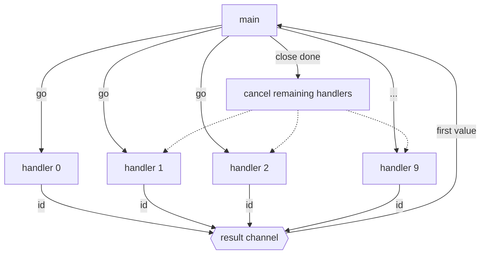
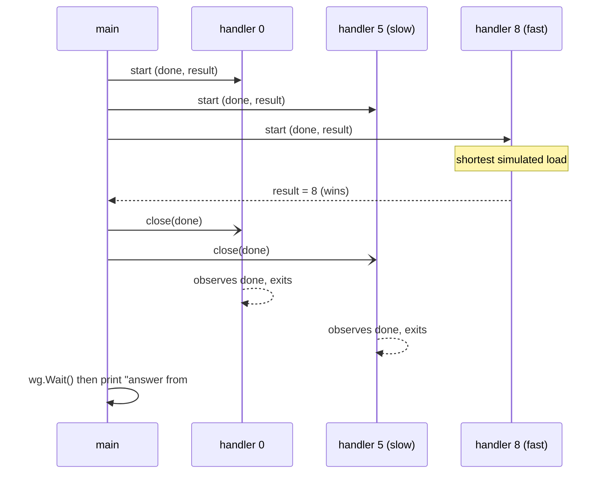
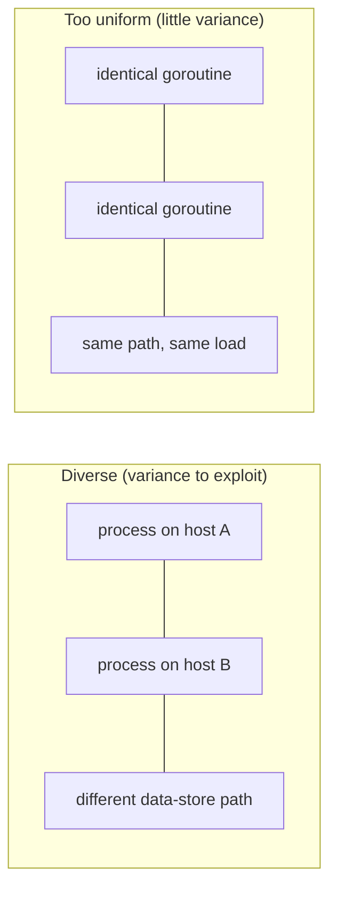

# Ch 5.4 — Replicated Requests

> Book: *Concurrency in Go* (Katherine Cox-Buday, O'Reilly 2017) · Chapter 5: Concurrency at Scale · Pages ~172–174
> ⬅️ Prev: [Heartbeats](03-heartbeats.md) · ➡️ Next: [Rate Limiting — Token Bucket](05-rate-limiting-token-bucket.md) · 🏠 [Book index](README.md)

## 🎯 In One Paragraph

When returning a response *as fast as possible* is the top priority (servicing a user's HTTP request, fetching a replicated blob), you can **replicate the request** across multiple handlers — goroutines, processes, or servers — and take whichever responds first, cancelling the rest. You trade extra resource usage for lower latency: in-memory replication is cheap, but replicating processes, servers, or data centers can be expensive, so the decision hinges on whether the cost is worth the benefit. The pattern is simple in Go: fan out N handlers that each write their id to a shared `result` channel, read the **first** value, then `close(done)` to cancel the stragglers and `wg.Wait()` for them to exit. The crucial caveat is **diversity**: every handler must have an equal opportunity to service the request (its needed resources must all be replicated), and handlers that are too *uniform* rarely produce an outlier — so replicate across handlers with genuinely different runtime conditions (different processes, machines, data-store paths, or data stores). Done well, this both lowers tail latency and provides fault tolerance and scalability.

## 🧠 Key Concepts & Vocabulary

- **Replicated request**: Sending the same request to multiple handlers simultaneously and using the first response that returns.
- **Handler**: A unit that can service the request — a goroutine, process, or server. Whatever resource it needs must be replicated too.
- **First-returned-wins**: Read a single value from the shared `result` channel; that is the fastest handler.
- **Cancel the losers**: After the first result, `close(done)` so the remaining handlers stop doing unnecessary work, then `wg.Wait()` for them to finish.
- **Equal opportunity**: Every handler must be *able* to service the request; a handler that can't service it can't win.
- **Uniformity problem**: If handlers are too alike, none is likely to be a fast outlier. Diversify runtime conditions (process, machine, path, data store) to get variance you can exploit.
- **Cost/benefit trade-off**: In-memory replication is cheap; replicating processes/servers/data centers is costly. Replicate only when latency matters enough.
- **Side benefits**: Natural fault tolerance (a crashed handler just loses the race) and scalability.

## 📚 Deep Dive

### The pattern

Ten handlers each sleep a random "load time," then try to send their id on `result`. `main` reads one value (the winner), cancels the rest, and waits.





### The program

```go
package main

import (
    "fmt"
    "math/rand"
    "sync"
    "time"
)

func doWork(done <-chan any, id int, wg *sync.WaitGroup, result chan<- int) {
    started := time.Now()
    defer wg.Done()

    // Simulate random load. (Book uses 1-6 seconds; we scale to ms for a fast demo.)
    simulatedLoadTime := time.Duration(1+rand.Intn(5)) * 20 * time.Millisecond
    select {
    case <-done:
    case <-time.After(simulatedLoadTime):
    }

    select {
    case <-done:
    case result <- id: // try to report our id
    }

    took := time.Since(started)
    if took < simulatedLoadTime {
        took = simulatedLoadTime
    }
    fmt.Printf("%v took %v\n", id, took)
}

func main() {
    done := make(chan any)
    result := make(chan int)

    var wg sync.WaitGroup
    wg.Add(10)

    for i := 0; i < 10; i++ {
        go doWork(done, i, &wg, result) // 10 handlers
    }

    firstReturned := <-result // fastest handler wins
    close(done)               // cancel the rest so they stop working
    wg.Wait()

    fmt.Printf("Received an answer from #%v\n", firstReturned)
}
```

**Verified output** (one run; load scaled to ms so the demo is quick):

```text
9 took 60ms
2 took 20.296002ms
6 took 40ms
3 took 40ms
0 took 20.506257ms
8 took 20.49305ms
5 took 100ms
1 took 60ms
7 took 40ms
4 took 80ms
Received an answer from #2
```

The printed "took" values show what each handler *would* have taken. If you'd spun up only one handler and it happened to be the slowest (here #5 at 100ms, or in the book's seconds-scaled run, 5 seconds), you'd wait that long. Replication lets you pay for the *fastest* of N instead of the luck of 1.

> 🆕 Modern Go note (`rand`): since Go 1.20 the global `math/rand` source is auto-seeded, so you no longer need `rand.Seed(time.Now().UnixNano())`. For reproducible tests use an explicit `rand.New(rand.NewSource(seed))` or the newer `math/rand/v2`.

### Why diversity matters

Two related requirements:

1. **Equal opportunity.** A handler that cannot service the request can never win the race, so you don't benefit from it. Every resource a handler needs (connection, cache, disk, data store) must be replicated.
2. **Avoid uniformity.** If handlers share identical runtime conditions, they tend to finish at similar times, so none is a fast outlier — defeating the purpose. Replicate across handlers with *different* runtime conditions: separate processes, machines, data-store paths, or entirely different data stores.



### Cost, and the bigger picture

Replication costs resources proportional to how heavy a handler is. In-memory handlers are cheap; replicating whole servers or data centers is expensive. When speed is the goal, it is a valuable technique and, as a bonus, provides **fault tolerance** (a dead handler simply loses) and **scalability**.

This pattern is the single-process cousin of **hedged requests** from Google's *The Tail at Scale* (Dean & Barroso, 2013): rather than firing all replicas at once, production systems often send a backup request only *after* the primary exceeds its expected latency, cutting p99 dramatically for a small cost overhead.

## ⚠️ Pitfalls & Gotchas

- **Leaking the losers.** Always `close(done)` after the first result and `wg.Wait()`; otherwise straggler handlers keep consuming resources (goroutine/connection leaks).
- **Unbuffered result channel + no cancellation.** Losers block forever trying to send on `result`. The `select { case <-done: case result <- id: }` is what lets them bail out.
- **Replicating too uniformly.** Identical handlers give almost no latency variance, so you pay N× cost for nearly no speedup. Diversify runtime conditions.
- **Handlers without equal opportunity.** A replica that can't actually serve the request adds cost without a chance of winning.
- **Ignoring the duplicate-work bill.** With server/data-center replicas, firing all at once multiplies load. Consider *hedging* (delayed backups) to bound the overhead.
- **Non-idempotent side effects.** If handlers mutate shared state, multiple replicas may each perform the effect. Make the work read-only/idempotent, or ensure only the winner commits.

## 🆕 Modern Go Notes

> [!note] 🆕 `errgroup` and modern primitives for first-result fan-out
> The book hand-rolls the fan-out with `sync.WaitGroup` + `done` + a `result` channel. Modern Go offers cleaner building blocks:
> - **`golang.org/x/sync/errgroup`** bundles a `WaitGroup`, first-error collection, and `context` cancellation. With `errgroup.WithContext`, the first handler to finish can cancel the rest via the shared context — ideal for "first wins, cancel losers."
> - **`errgroup.SetLimit(n)`** bounds how many replicas run at once (backpressure), avoiding unbounded fan-out.
> - **`sync.WaitGroup.Go` (Go 1.25)** adds `wg.Go(func(){...})`, removing manual `Add(1)`/`defer Done()` bookkeeping.
> - **`context.AfterFunc` (Go 1.21)** is handy to implement *hedging*: schedule a backup request to start only after a delay if the primary hasn't returned.
> - **`math/rand/v2` (Go 1.22)** is the modern RNG API; the global `math/rand` is auto-seeded since Go 1.20.

Sketch of the same idea with `errgroup` + context (illustrative):

```go
// fastest handler cancels the rest via ctx; first result sent on a buffered chan.
g, ctx := errgroup.WithContext(context.Background())
result := make(chan int, 1)
for i := 0; i < 10; i++ {
    id := i // (per-iteration var is automatic since Go 1.22)
    g.Go(func() error {
        select {
        case <-time.After(randomLoad()):
            select {
            case result <- id:
            default: // someone already won
            }
            return nil
        case <-ctx.Done():
            return ctx.Err() // canceled loser exits promptly
        }
    })
}
```

## 🧪 Try It Yourself

1. Replace the hand-rolled fan-out with `errgroup.WithContext` and confirm the losers exit via `ctx.Done()`.
2. Implement *hedging* with `context.AfterFunc`: start handler #2 only if handler #1 hasn't returned within a delay; measure the resource savings vs. firing all at once.
3. Make the handlers deliberately uniform (fixed load) and show the latency win collapses; then diversify and show it returns.
4. Add a counter of how many handlers were still running when the winner returned, to quantify wasted work.

## ✅ Self-Check Questions

<details><summary>What is a replicated request and what trade-off does it make?</summary>
Sending the same request to multiple handlers and using the first response. It trades extra resource usage (running N copies) for lower latency — you get the fastest of N instead of gambling on a single handler.
</details>

<details><summary>After the first result arrives, what two things must `main` do, and why?</summary>
`close(done)` to cancel the remaining handlers so they stop doing unnecessary work, and `wg.Wait()` to ensure they've exited — preventing goroutine/resource leaks.
</details>

<details><summary>Why does replicating across uniform handlers defeat the purpose?</summary>
Uniform handlers finish at similar times, so none is a fast outlier. You pay N× cost for almost no latency improvement. You want handlers with different runtime conditions to create exploitable variance.
</details>

<details><summary>What is "equal opportunity" and why does it matter?</summary>
Every handler must actually be able to service the request (all its needed resources replicated). A handler that can't serve the request can never win the race, so it only adds cost.
</details>

<details><summary>What side benefits does replication provide beyond speed?</summary>
Fault tolerance (a crashed handler simply loses the race) and scalability.
</details>

<details><summary>How does this relate to "hedged requests" in distributed systems?</summary>
It's the single-process version. Hedged requests (from *The Tail at Scale*) send a backup request only after the primary exceeds its expected latency, getting most of the tail-latency benefit for a small fraction of the cost of firing all replicas at once.
</details>

<details><summary>What must be true of the handlers' side effects for replication to be safe?</summary>
The work should be read-only or idempotent; otherwise each replica may perform the effect. If there are side effects, ensure only the winning handler commits them.
</details>

## 🔑 Key Takeaways

- Replicate a request across diverse handlers and take the first response to minimize latency.
- Read the first result, then `close(done)` and `wg.Wait()` to cancel and reap the losers.
- Handlers need **equal opportunity** (all resources replicated) and **diversity** (different runtime conditions) to be worth the cost.
- The technique trades resources for speed and adds fault tolerance and scalability.
- Modern Go: prefer `errgroup.WithContext` (+`SetLimit`) and `wg.Go` (1.25); consider *hedging* (delayed backups via `context.AfterFunc`) to bound cost.

## 🔗 References & Further Reading

📝 Blogs/articles:
- [The Tail at Scale — Dean & Barroso, Communications of the ACM (2013)](https://cacm.acm.org/research/the-tail-at-scale/) — the foundational paper on tail latency and hedged/replicated requests.
- [What is tail latency? Why p99 spikes when averages look fine — ClickHouse](https://clickhouse.com/resources/engineering/tail-latency) — explains why fan-out amplifies slow responses, motivating replication.
- [errgroup vs WaitGroup vs Channels — dev.to](https://dev.to/gabrielanhaia/errgroup-vs-waitgroup-vs-channels-pick-the-right-concurrency-primitive-d7e) — choosing the right primitive for first-result fan-out and cancellation.
- [Bounding Concurrency in Go: errgroup, Worker Pools, and Backpressure — dev.to](https://dev.to/rosgluk/bounding-concurrency-in-go-errgroup-worker-pools-and-backpressure-1eh4) — avoiding unbounded fan-out when replicating.

💻 GitHub:
- [golang/sync — errgroup](https://github.com/golang/sync/blob/master/errgroup/errgroup.go) — the source of the modern first-error/cancel-siblings primitive.
- [bhope/hedge](https://github.com/bhope/hedge) — adaptive hedged requests in Go based on *The Tail at Scale*; the production evolution of this pattern.

📖 Official docs/specs:
- [golang.org/x/sync/errgroup — pkg.go.dev](https://pkg.go.dev/golang.org/x/sync/errgroup) — `Group`, `WithContext`, `SetLimit`.
- [sync.WaitGroup — pkg.go.dev](https://pkg.go.dev/sync#WaitGroup) — including the Go 1.25 `WaitGroup.Go` method.
- [context.AfterFunc — pkg.go.dev](https://pkg.go.dev/context#AfterFunc) — useful for implementing delayed hedged requests.
