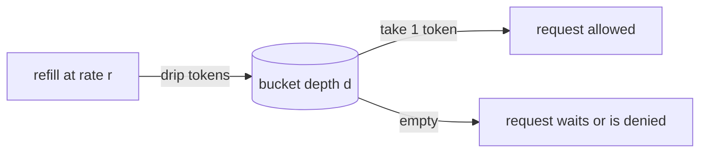
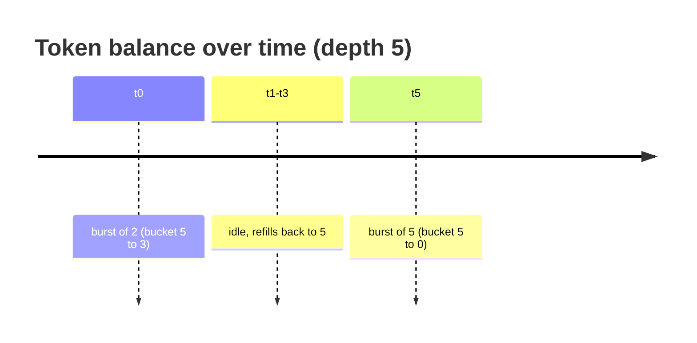
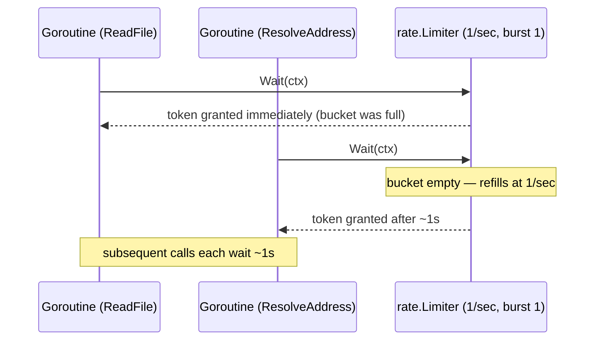

# Ch 5.5 — Rate Limiting (the Token Bucket)

> Book: *Concurrency in Go* (Katherine Cox-Buday, O'Reilly 2017) · Chapter 5: Concurrency at Scale · Pages ~174–183
> ⬅️ Prev: [Replicated Requests](04-replicated-requests.md) · ➡️ Next: [Multi-Tier Rate Limiting](06-multi-tier-rate-limiting.md) · 🏠 [Book index](README.md)

## 🎯 In One Paragraph

**Rate limiting** constrains how often a resource may be accessed to some finite number per unit of time — API calls, disk reads/writes, network packets, even errors. You want it even when you think the limit will never be hit: it blocks entire classes of attack (DoS, brute force, filling disks/log rotation), it protects legitimate users from each other (one buggy or heavy client can degrade or even self-DDoS a distributed system), it keeps the system inside performance boundaries you've actually tested, and — when you charge for access — it protects *both* parties from a runaway-loop bill. The near-universal algorithm is the **token bucket**: a bucket of depth `d` holds up to `d` access tokens; each access removes one token; tokens are refilled at rate `r`. `d` controls **burstiness** (how many requests you can fire when the bucket is full) and `r` controls the **steady-state rate**. Between them you tune both the sustained limit and the burst allowance. The book implements this with Go's near-standard `golang.org/x/time/rate` package: `rate.NewLimiter(r, b)` plus `limiter.Wait(ctx)` to block until a token is available, wrapped inside an `APIConnection` so every call waits for its token first.

## 🧠 Key Concepts & Vocabulary

- **Rate limiting**: Capping accesses to a resource per unit time. The resource can be anything — API connections, disk I/O, network packets, errors.
- **Why limit** (even if "never reached"): prevent attack vectors (DoS, brute force, disk/log-rotation abuse); protect users from each other (avoid one client degrading others, prevent death-spirals); stay within tested performance boundaries; protect paying customers (and yourself) from runaway-loop bills; let users self-throttle while learning an API.
- **Token bucket**: The standard algorithm. A bucket of **depth `d`** holds up to `d` tokens; each access removes one; tokens refill at **rate `r`**.
- **`d` (depth / burst)**: Maximum tokens held → **burstiness** = how many requests you can make when the bucket is full.
- **`r` (rate)**: Refill rate → the sustained **rate limit**. "We wait until new tokens become available, so operations are limited to that refresh rate."
- **Burstiness is not one big stream**: Depth only caps capacity; a user may spend a small burst, idle (accruing tokens), then spend another burst up to the current balance.
- **`golang.org/x/time/rate`**: Go's near-standard token-bucket implementation. Chosen because it's "as close to the standard library as I could get."
- **`rate.Limit`**: `type Limit float64` — events per second. Zero allows no events; `rate.Inf` means no limit.
- **`rate.NewLimiter(r Limit, b int)`**: Build a limiter allowing rate `r` with burst `b` (the bucket depth).
- **`rate.Every(interval)`**: Convert a minimum inter-event interval into a `Limit`; returns `rate.Inf` for a zero interval.
- **`Wait` / `WaitN`**: `Wait(ctx)` = `WaitN(ctx, 1)`; blocks until the limiter permits `n` events, erroring if `n > burst`, the context is canceled, or the expected wait exceeds the context deadline.
- **`Per(eventCount, duration)` helper**: `rate.Every(duration / time.Duration(eventCount))` — express a limit as "N events per duration" instead of an inter-event interval.

## 📚 Deep Dive

### The token-bucket model, step by step

A bucket of depth 5, rate 1 token/sec. Five immediate requests drain it; then one request every second as tokens refill.



Depth vs. rate time-tables (from the book):

**Depth 1, rate 1/sec** — immediate request, then one every other second:

| time | bucket | request |
|---|---|---|
| 0 | 1 → 0 | tok |
| 1 | 0 | |
| 2 | 1 → 0 | tok |
| 3 | 0 | |
| 4 | 1 → 0 | tok |

**Depth 5, rate 0.5/sec** — a burst of 5, then one every two seconds:

| time | bucket | request |
|---|---|---|
| 0 | 5 → 0 | tok ×5 |
| 1 | 0 (0.5) | |
| 2 | 1 → 0 | tok |
| 3 | 0 (0.5) | |
| 4 | 1 → 0 | tok |

**Intermittent bursts** — depth only caps capacity; a user can burst 2, idle to refill, then burst 5:

| time | bucket | request |
|---|---|---|
| 0 | 5 → 3 | tok ×2 |
| 1–3 | 3 → 5 | (idle, refilling) |
| 5 | 5 → 0 | tok ×5 |



### No limiter: everything fires at once

The baseline driver reads 10 files and resolves 10 addresses concurrently. With no limiter, all 20 complete in the same second — and a buggy infinite loop here could run up a nasty bill.

```go
func Open() *APIConnection { return &APIConnection{} }
type APIConnection struct{}
func (a *APIConnection) ReadFile(ctx context.Context) error       { return nil }
func (a *APIConnection) ResolveAddress(ctx context.Context) error { return nil }
```

Book output: all 20 lines timestamped `20:13:13` — simultaneous.

### Adding a token-bucket limiter

Put the limiter inside `APIConnection` (in production it'd live server-side; a client-side limiter is an optimization that keeps the demo simple). `rate.NewLimiter(rate.Limit(1), 1)` = 1 event/sec, burst 1; every method calls `rateLimiter.Wait(ctx)` first.

```go
package main

import (
    "context"
    "log"
    "os"
    "sync"

    "golang.org/x/time/rate"
)

func Open() *APIConnection {
    return &APIConnection{
        rateLimiter: rate.NewLimiter(rate.Limit(1), 1), // 1 event/sec, burst 1
    }
}

type APIConnection struct {
    rateLimiter *rate.Limiter
}

func (a *APIConnection) ReadFile(ctx context.Context) error {
    if err := a.rateLimiter.Wait(ctx); err != nil { // block for a token
        return err
    }
    return nil // pretend we do work here
}

func (a *APIConnection) ResolveAddress(ctx context.Context) error {
    if err := a.rateLimiter.Wait(ctx); err != nil {
        return err
    }
    return nil
}

func main() {
    defer log.Printf("Done.")
    log.SetOutput(os.Stdout)
    log.SetFlags(log.Ltime | log.LUTC)

    apiConnection := Open()
    var wg sync.WaitGroup
    wg.Add(20)

    for i := 0; i < 10; i++ {
        go func() {
            defer wg.Done()
            if err := apiConnection.ReadFile(context.Background()); err != nil {
                log.Printf("cannot ReadFile: %v", err)
            }
            log.Printf("ReadFile")
        }()
    }
    for i := 0; i < 10; i++ {
        go func() {
            defer wg.Done()
            if err := apiConnection.ResolveAddress(context.Background()); err != nil {
                log.Printf("cannot ResolveAddress: %v", err)
            }
            log.Printf("ResolveAddress")
        }()
    }
    wg.Wait()
}
```

**Verified output** (first lines; one completion per second — scratch module with `golang.org/x/time v0.16.0`):

```text
20:27:17 ReadFile
20:27:18 ResolveAddress
20:27:19 ResolveAddress
20:27:20 ResolveAddress
...
```



### The `rate` API the book relies on

```go
// Limit = events per second. Zero allows no events.
type Limit float64

// NewLimiter: allow events up to rate r, with bursts of at most b tokens.
func NewLimiter(r Limit, b int) *Limiter

// Every: convert a minimum inter-event interval to a Limit (rate.Inf if interval==0).
func Every(interval time.Duration) Limit

// Wait == WaitN(ctx, 1); blocks until a token is available or ctx ends.
func (lim *Limiter) Wait(ctx context.Context) (err error)
func (lim *Limiter) WaitN(ctx context.Context, n int) (err error)
```

A convenience the next section builds on — express limits as *N events per duration*:

```go
func Per(eventCount int, duration time.Duration) rate.Limit {
    return rate.Every(duration / time.Duration(eventCount))
}
```

The book defines `Per` in terms of `Every` (rather than `rate.Limit(events/timePeriod.Seconds())`) precisely so a zero interval yields `rate.Inf` instead of a divide-by-zero or a meaningless limit.

> The book notes `rate.Limiter` has more tricks (it covers only `Wait` here). In modern terms those are `Allow`/`AllowN` (non-blocking check), `Reserve`/`ReserveN` (schedule a future slot and learn the delay), and `SetLimit`/`SetBurst` (adjust at runtime).

## ⚠️ Pitfalls & Gotchas

- **`WaitN(ctx, n)` with `n > burst` always errors.** You can never wait for more tokens than the bucket can ever hold. Size `burst` ≥ the largest single request.
- **Client-side only is bypassable.** A client-side limiter is a convenience/optimization; the authoritative limit must live server-side where users can't trivially skip it.
- **Divide-by-zero / `rate.Inf` surprises with `Every`.** `rate.Every(0)` returns `rate.Inf` (no limit). Define helpers in terms of `Every` so a zero interval degrades to "unlimited" rather than panicking.
- **Confusing depth with sustained rate.** `d` (burst) caps how many you can fire *now*; `r` sets the *sustained* rate. They're independent knobs.
- **Assuming a burst must be one contiguous stream.** Idle time accrues tokens; a user can split bursts across time up to the current balance.
- **Ignoring context deadlines in `Wait`.** If the expected wait exceeds the context deadline, `Wait` returns an error immediately — handle it rather than assuming the call always blocks until a token arrives.
- **Thinking you don't need limits.** Even one user with a buggy loop can self-DDoS a distributed system or generate a runaway bill. Add limits proactively.

## 🆕 Modern Go Notes

> [!note] 🆕 `golang.org/x/time/rate` has stayed stable; the broader methods are worth knowing
> The book (2017) uses only `Wait`. The package is still the near-standard token bucket; useful additions/clarifications:
> - **`Allow()` / `AllowN(t, n)`** — non-blocking: returns `true` if a token is available *now* (reject-on-empty, e.g. return HTTP 429).
> - **`Reserve()` / `ReserveN(t, n)`** — returns a `*Reservation` whose `Delay()` tells you how long to wait; call `r.Cancel()` to return the token if you abandon the request.
> - **`SetLimit` / `SetBurst`** — change the rate/burst at runtime (e.g. tier changes).
> - The three methods (`Allow`, `Reserve`, `Wait`) share one bucket but differ on overload: `Allow` rejects immediately, `Reserve` schedules a future slot, `Wait` blocks until capacity or `ctx` ends.
> - **`math/rand/v2`** and auto-seeding are unrelated here but note `rate` uses a monotonic clock internally, so system-clock changes don't corrupt token accounting.
> - For a **leaky-bucket** (strict, no-burst) alternative, see `uber-go/ratelimit`.

## 🧪 Try It Yourself

1. Swap `Wait` for `Allow` and return an error (simulating HTTP 429) when the bucket is empty; observe how many of the 20 calls are rejected.
2. Use `Reserve()` and print `r.Delay()` for each call to see the scheduled wait; cancel a reservation and confirm the token returns.
3. Set burst to 5 and rate to 1/sec; verify you get an immediate burst of 5, then one per second.
4. Call `SetLimit(rate.Inf)` midway and confirm the remaining calls fire instantly.

## ✅ Self-Check Questions

<details><summary>What do the two token-bucket parameters `d` and `r` control?</summary>
`d` (bucket depth / burst) controls burstiness — how many requests you can make when the bucket is full. `r` (refill rate) controls the sustained rate limit — how fast tokens come back, i.e. the long-run allowed rate.
</details>

<details><summary>Give three distinct reasons to add rate limiting even if you think the limit won't be hit.</summary>
Any three of: block attack vectors (DoS/brute-force/disk-filling); protect users from each other and prevent death-spirals; keep the system within tested performance boundaries; protect paying customers (and yourself) from runaway-loop bills; let users self-throttle while learning an API.
</details>

<details><summary>What does `rate.NewLimiter(rate.Limit(1), 1)` mean, and what throughput does it produce?</summary>
Rate 1 event/second with a burst (depth) of 1. After the initial token, it permits roughly one event per second.
</details>

<details><summary>Why define `Per` in terms of `rate.Every` rather than `rate.Limit(events/seconds)`?</summary>
Because `Every` has special logic returning `rate.Inf` (no limit) when the interval is zero, avoiding a divide-by-zero / meaningless limit and giving sensible "unlimited" behavior for a zero interval.
</details>

<details><summary>What happens if you call `WaitN(ctx, n)` with `n` larger than the limiter's burst?</summary>
It returns an error — you can never obtain more tokens at once than the bucket's maximum capacity (burst).
</details>

<details><summary>How do `Allow`, `Reserve`, and `Wait` differ under overload?</summary>
They share one bucket but: `Allow` rejects immediately without consuming capacity if none is free; `Reserve` schedules a future slot and tells you the delay; `Wait` blocks the goroutine until capacity is available or the context ends.
</details>

<details><summary>Can a user spend their whole burst only as one contiguous stream?</summary>
No. Depth only caps capacity. A user can spend a small burst, idle while tokens accrue, then spend another burst up to the current token balance.
</details>

## 🔑 Key Takeaways

- Rate limiting caps accesses per unit time to any resource; add it proactively — it prevents attacks, protects users, bounds tested performance, and guards against runaway bills.
- The **token bucket** uses depth `d` (burst) and refill rate `r` (sustained limit) as independent knobs.
- `golang.org/x/time/rate` is the near-standard Go implementation: `NewLimiter(r, b)`, `Every`, and `Wait(ctx)`/`WaitN`.
- Define a `Per(n, duration)` helper via `rate.Every` to express limits naturally and avoid zero-interval pitfalls.
- Wrap the limiter so every operation `Wait`s for a token first; place the authoritative limiter server-side.
- Know the fuller API: `Allow` (reject), `Reserve` (schedule), `Wait` (block), plus `SetLimit`/`SetBurst`.

## 🔗 References & Further Reading

📝 Blogs/articles:
- [Rate Limiting Go Services with golang.org/x/time/rate — ByteSizeGo](https://www.bytesizego.com/blog/rate-limiting-go-services-with-golang-org-x-time-rate) — clear breakdown of `Allow` vs `Reserve` vs `Wait` sharing one bucket.
- [Rate Limiting in Go With golang.org/x/time/rate — dev.to](https://dev.to/gabrielanhaia/rate-limiting-in-go-with-golangorgxtimerate-45b8) — practical `NewLimiter(r, b)` usage and burst semantics.
- [API Rate Limiting Strategies (2026 engineering reference) — Digital Applied](https://www.digitalapplied.com/blog/api-rate-limiting-strategies-2026-engineering-reference) — token vs leaky vs sliding-window trade-offs grounded in Cloudflare production data.
- [Uber's Go Rate Limiter: A Leaky-Bucket Implementation — Medium](https://medium.com/@linz07m/ubers-go-rate-limiter-a-leaky-bucket-implementation-20639db69982) — contrast with the strict no-burst leaky-bucket approach.

💻 GitHub:
- [golang/time (x/time/rate)](https://github.com/golang/time) — the canonical token-bucket limiter the book uses.
- [uber-go/ratelimit](https://github.com/uber-go/ratelimit) — a popular leaky-bucket (blocking, no-burst) alternative; good comparison point.

📖 Official docs/specs:
- [golang.org/x/time/rate — pkg.go.dev](https://pkg.go.dev/golang.org/x/time/rate) — `Limit`, `NewLimiter`, `Every`, `Wait`/`WaitN`, `Allow`, `Reserve`.
- [golang/time limiter API — DeepWiki](https://deepwiki.com/golang/time/2.2-limiter-api) — annotated walkthrough of the three limiting patterns.
- [kat-co/concurrency-in-go-src](https://github.com/kat-co/concurrency-in-go-src) — the book's official source for the rate-limiting examples.
