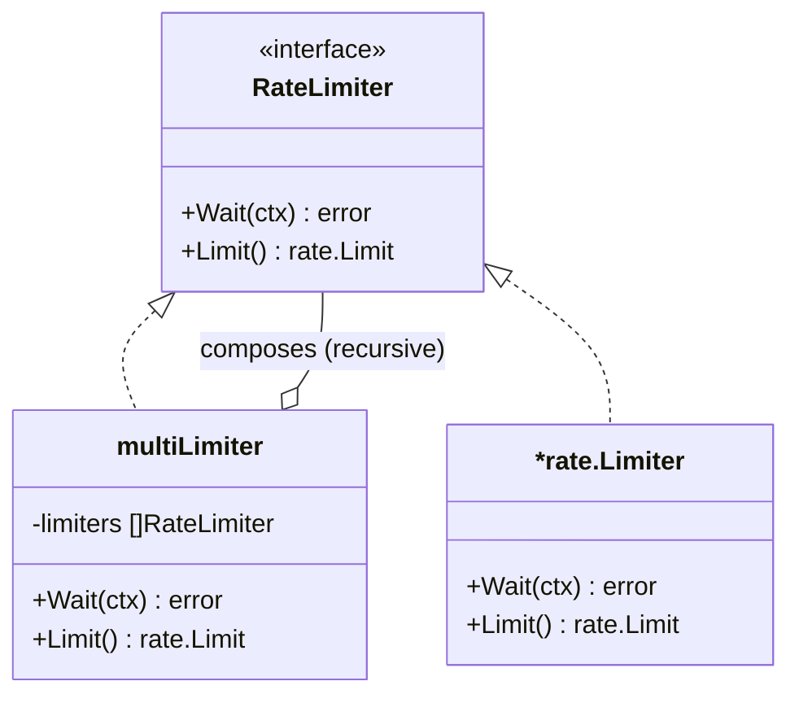
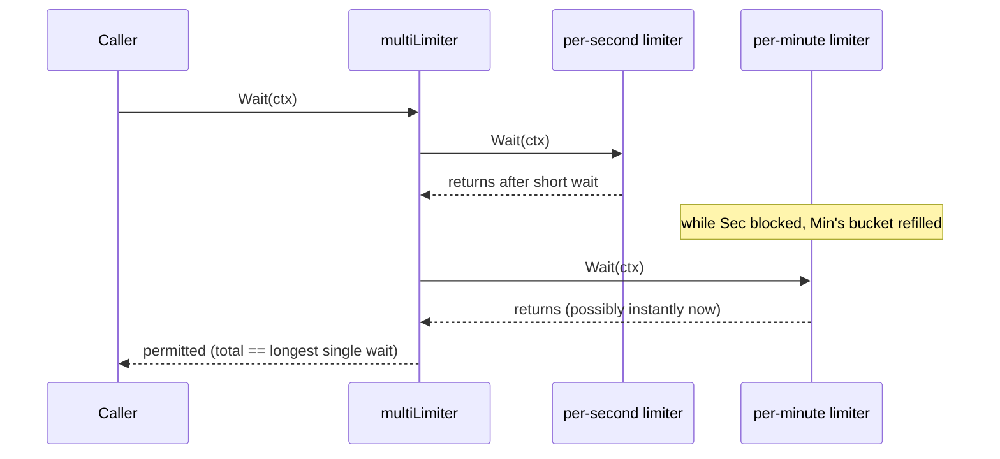
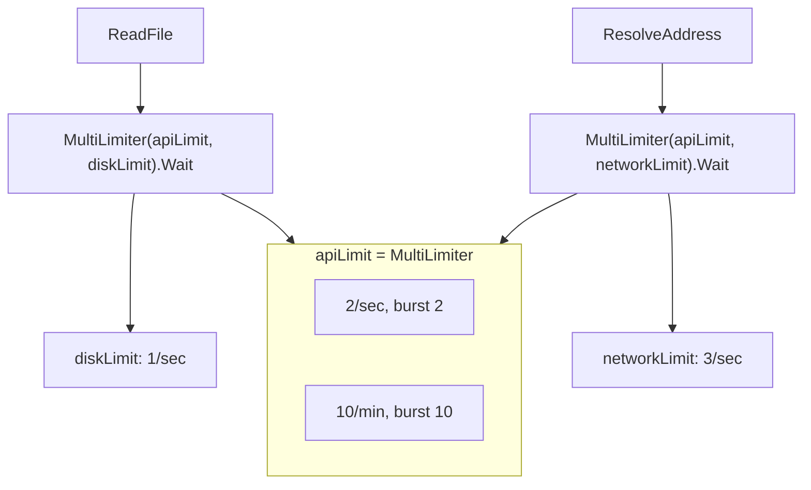

# Ch 5.6 — Multi-Tier Rate Limiting

> Book: *Concurrency in Go* (Katherine Cox-Buday, O'Reilly 2017) · Chapter 5: Concurrency at Scale · Pages ~183–188
> ⬅️ Prev: [Rate Limiting — Token Bucket](05-rate-limiting-token-bucket.md) · ➡️ Next: [Healing Unhealthy Goroutines](07-healing-unhealthy-goroutines.md) · 🏠 [Book index](README.md)

## 🎯 In One Paragraph

A single token-bucket limiter rarely suffices in production. You usually want **multiple tiers of limits** — fine-grained (per second) *and* coarse-grained (per minute/hour/day) — and you want to limit across **multiple dimensions** (API calls, disk, network) at once. You *could* try to cram several time scales into one limiter, but you'd lose the information about each limit's *intent*. The book's answer is a small aggregate limiter, **`multiLimiter`**, that composes several `RateLimiter`s and presents them as one. Its `Wait` simply loops over every child limiter and `Wait`s on each; because the children all get notified (each decrements its own bucket), the total wait equals the *longest* single wait — smaller waits that finish early let the shorter buckets refill, so later waits return instantly. `multiLimiter` sorts its children by limit on construction so `Limit()` can cheaply return the most restrictive one. With this you can declare per-second + per-minute API limits, a per-second disk limit, and a per-second network limit, then combine exactly the relevant limiters for each call (`ReadFile` → API + disk; `ResolveAddress` → API + network). The observed behavior: an initial burst governed by the finer limits, then throttling as the coarse (per-minute) pool drains — with a subtle twist that the 11th request arrives early because the per-minute limiter is a *sliding window* that has already accrued a fresh token.

## 🧠 Key Concepts & Vocabulary

- **Multi-tier rate limiting**: Enforcing several limits at different time scales (per second *and* per minute/hour/day) and/or across different resource dimensions simultaneously.
- **`RateLimiter` interface**: `Wait(context.Context) error` + `Limit() rate.Limit`. Lets a `multiLimiter` hold both plain `*rate.Limiter`s and *other* `multiLimiter`s (recursive composition).
- **`multiLimiter`**: An aggregate limiter whose `Wait` calls `Wait` on every child, so a request is only permitted when *all* tiers permit it.
- **Sorting by limit**: On construction, children are sorted ascending by `Limit()`. Then `Limit()` returns `limiters[0].Limit()` — the most restrictive — in O(1).
- **Longest-wait property**: Waiting on each child in turn yields a total wait equal to the longest single wait. While earlier (shorter) waits block, the other buckets refill, so later waits return instantly.
- **Composing by dimension**: Build separate limiters for API/disk/network, then `MultiLimiter(a.apiLimit, a.diskLimit)` (etc.) per call to combine only the relevant ones.
- **Sliding-window refill**: `rate`'s per-minute limiter accrues tokens continuously, not in discrete minute buckets — which is why the 11th request can appear sooner than the steady throttled cadence.

## 📚 Deep Dive

### The `multiLimiter` type

```go
package main

import (
    "context"
    "sort"
    "time"

    "golang.org/x/time/rate"
)

func Per(eventCount int, duration time.Duration) rate.Limit {
    return rate.Every(duration / time.Duration(eventCount))
}

type RateLimiter interface {
    Wait(context.Context) error
    Limit() rate.Limit
}

func MultiLimiter(limiters ...RateLimiter) *multiLimiter {
    byLimit := func(i, j int) bool {
        return limiters[i].Limit() < limiters[j].Limit()
    }
    sort.Slice(limiters, byLimit) // sort ascending so [0] is most restrictive
    return &multiLimiter{limiters: limiters}
}

type multiLimiter struct {
    limiters []RateLimiter
}

func (l *multiLimiter) Wait(ctx context.Context) error {
    for _, lim := range l.limiters {
        if err := lim.Wait(ctx); err != nil { // notify EVERY tier
            return err
        }
    }
    return nil
}

func (l *multiLimiter) Limit() rate.Limit {
    return l.limiters[0].Limit() // most restrictive (sorted)
}
```



### How `Wait` produces the longest wait



Each child must be notified so it decrements its own bucket. Because the shorter waits complete first and the other buckets refill meanwhile, the aggregate wait converges to the single longest wait rather than the sum.

### Two tiers: per second + per minute

```go
func Open() *APIConnection {
    secondLimit := rate.NewLimiter(Per(2, time.Second), 1)   // 2/sec, no burst
    minuteLimit := rate.NewLimiter(Per(10, time.Minute), 10) // 10/min, burst 10 (initial pool)
    return &APIConnection{
        rateLimiter: MultiLimiter(secondLimit, minuteLimit),
    }
}

type APIConnection struct{ rateLimiter RateLimiter }

func (a *APIConnection) ReadFile(ctx context.Context) error {
    if err := a.rateLimiter.Wait(ctx); err != nil {
        return err
    }
    return nil
}
func (a *APIConnection) ResolveAddress(ctx context.Context) error {
    if err := a.rateLimiter.Wait(ctx); err != nil {
        return err
    }
    return nil
}
```

The per-minute limiter has burst 10 to give users an initial pool; the per-second limiter keeps them from overwhelming the system. **Book output** (abridged): two requests per second up through request #11, then one every ~6 seconds once the per-minute pool drains.

> Why does request #11 come after only ~2 seconds rather than ~6 like the rest? Because the per-minute limit is a *sliding window*: by the 11th request the per-minute limiter has already accrued another token. The coarse limit is 10/min, but tokens trickle back continuously.

### Many dimensions: API + disk + network

```go
func Open() *APIConnection {
    return &APIConnection{
        apiLimit: MultiLimiter(
            rate.NewLimiter(Per(2, time.Second), 2),
            rate.NewLimiter(Per(10, time.Minute), 10),
        ),
        diskLimit:    MultiLimiter(rate.NewLimiter(rate.Limit(1), 1)),   // 1 read/sec
        networkLimit: MultiLimiter(rate.NewLimiter(Per(3, time.Second), 3)), // 3/sec
    }
}

type APIConnection struct {
    networkLimit,
    diskLimit,
    apiLimit RateLimiter
}

func (a *APIConnection) ReadFile(ctx context.Context) error {
    // combine only the relevant limiters for this call
    return MultiLimiter(a.apiLimit, a.diskLimit).Wait(ctx)
}
func (a *APIConnection) ResolveAddress(ctx context.Context) error {
    return MultiLimiter(a.apiLimit, a.networkLimit).Wait(ctx)
}
```

`ReadFile` is bounded by API + disk; `ResolveAddress` by API + network. **Verified** (scratch module, `golang.org/x/time v0.16.0`, bounded run) — the characteristic shape is a ~2/sec burst, then throttling to ~every 6 s as the per-minute cap dominates:

```text
20:27:26 ResolveAddress
20:27:26 ResolveAddress
20:27:27 ResolveAddress
20:27:27 ResolveAddress
20:27:28 ResolveAddress
20:27:28 ResolveAddress
20:27:29 ResolveAddress
20:27:29 ReadFile
20:27:30 ReadFile
20:27:31 ReadFile
20:27:32 ResolveAddress
20:27:38 ReadFile
20:27:44 ReadFile
...
```

Network-access calls (`ResolveAddress`) finish with more regularity in the first two-thirds — likely the limiters doing their jobs (network limit 3/sec vs disk 1/sec), modulo goroutine scheduling.



### Why keep limits separate instead of one clever limiter

You can sometimes fold multiple time scales into a single limiter, but not always, and doing so "loses a lot of information around the intent of the rate limiter." Keeping each limit as its own named limiter preserves intent and lets you compose exactly the right subset per call. It also opens the door to limiting across non-time dimensions (disk, network, …), each expressed plainly.

### Complete runnable program

The following self-contained program combines the `multiLimiter`, the multi-dimensional `APIConnection`, and a bounded driver so you can run and observe the burst-then-throttle shape end to end. Verified with `go run` against `golang.org/x/time/rate`:

```go
package main

import (
	"context"
	"log"
	"os"
	"sort"
	"sync"
	"time"

	"golang.org/x/time/rate"
)

// Per converts "eventCount per duration" into a rate.Limit.
func Per(eventCount int, duration time.Duration) rate.Limit {
	return rate.Every(duration / time.Duration(eventCount))
}

// RateLimiter lets a multiLimiter hold *rate.Limiter and other multiLimiters.
type RateLimiter interface {
	Wait(context.Context) error
	Limit() rate.Limit
}

type multiLimiter struct {
	limiters []RateLimiter
}

// MultiLimiter composes children, sorted ascending so [0] is most restrictive.
func MultiLimiter(limiters ...RateLimiter) *multiLimiter {
	sort.Slice(limiters, func(i, j int) bool {
		return limiters[i].Limit() < limiters[j].Limit()
	})
	return &multiLimiter{limiters: limiters}
}

func (l *multiLimiter) Wait(ctx context.Context) error {
	for _, lim := range l.limiters {
		if err := lim.Wait(ctx); err != nil {
			return err
		}
	}
	return nil
}

func (l *multiLimiter) Limit() rate.Limit { return l.limiters[0].Limit() }

type APIConnection struct {
	networkLimit, diskLimit, apiLimit RateLimiter
}

func Open() *APIConnection {
	return &APIConnection{
		apiLimit: MultiLimiter(
			rate.NewLimiter(Per(2, time.Second), 2),
			rate.NewLimiter(Per(10, time.Minute), 10),
		),
		diskLimit:    MultiLimiter(rate.NewLimiter(rate.Limit(1), 1)),
		networkLimit: MultiLimiter(rate.NewLimiter(Per(3, time.Second), 3)),
	}
}

func (a *APIConnection) ReadFile(ctx context.Context) error {
	return MultiLimiter(a.apiLimit, a.diskLimit).Wait(ctx)
}

func (a *APIConnection) ResolveAddress(ctx context.Context) error {
	return MultiLimiter(a.apiLimit, a.networkLimit).Wait(ctx)
}

func main() {
	defer log.Printf("Done.")
	log.SetOutput(os.Stdout)
	log.SetFlags(log.Ltime | log.LUTC)

	apiConnection := Open()
	var wg sync.WaitGroup
	const total = 10 // bounded so the demo finishes quickly
	wg.Add(total * 2)

	for i := 0; i < total; i++ {
		go func() {
			defer wg.Done()
			if err := apiConnection.ReadFile(context.Background()); err != nil {
				log.Printf("cannot ReadFile: %v", err)
			}
			log.Printf("ReadFile")
		}()
	}
	for i := 0; i < total; i++ {
		go func() {
			defer wg.Done()
			if err := apiConnection.ResolveAddress(context.Background()); err != nil {
				log.Printf("cannot ResolveAddress: %v", err)
			}
			log.Printf("ResolveAddress")
		}()
	}
	wg.Wait()
}
```

Running it prints an initial burst (governed by the per-second and per-minute burst pools) that then throttles as the coarse per-minute cap drains — the same shape shown in the verified output above.

## ⚠️ Pitfalls & Gotchas

- **Summing instead of longest-wait reasoning.** `multiLimiter.Wait` loops over children; because shorter waits refill the other buckets, the total is the *longest* wait, not the sum. Don't double-count.
- **Forgetting to notify every tier.** Each child must be `Wait`ed so it decrements its bucket; skipping one makes that tier's accounting wrong.
- **Mis-sorting / wrong `Limit()`.** `Limit()` assumes ascending sort; if you forget `sort.Slice`, `limiters[0]` isn't the most restrictive and recursive composition misbehaves.
- **Burst on the coarse tier surprises you.** A per-minute burst of 10 gives an initial pool; the 11th request can slip in early due to sliding-window refill. Expected, but counterintuitive.
- **Constructing `MultiLimiter` per call is cheap but not free.** `ReadFile`/`ResolveAddress` build a fresh `MultiLimiter` each call (sorting a tiny slice). Fine here; for hot paths, build once and reuse.
- **Context cancellation short-circuits.** If one child's `Wait` returns an error (ctx canceled / deadline exceeded), the loop returns immediately and later tiers aren't notified — usually what you want, but be aware.

## 🆕 Modern Go Notes

> [!note] 🆕 Generics and modern composition
> The pattern is unchanged, but modern Go offers nicer expression:
> - The `RateLimiter` interface + `multiLimiter` is a textbook **composite pattern**; it still works verbatim. With generics you could parameterize other composite limiters, though it adds little here.
> - **`sort.Slice`** still works; **`slices.SortFunc` (Go 1.21)** is the modern, type-safe alternative: `slices.SortFunc(limiters, func(a, b RateLimiter) int { return cmp.Compare(a.Limit(), b.Limit()) })`.
> - For per-key (per-user / per-IP) multi-tier limiting, keep a `map[key]*multiLimiter` guarded by a `sync.Mutex`, or use `sync.Map`; evict idle entries to avoid unbounded growth.
> - `rate.Limiter` is safe for concurrent use, so sharing child limiters across goroutines (as the composite does) is fine.
> - Returned `*multiLimiter` satisfies `RateLimiter`, enabling the recursive composition the interface was designed for.

## 🧪 Try It Yourself

1. Add an hourly tier (`Per(100, time.Hour)`, burst 100) and observe where it starts to dominate.
2. Replace `sort.Slice` with `slices.SortFunc` + `cmp.Compare` and confirm identical behavior.
3. Build the `MultiLimiter` once in `Open()` (instead of per call) and benchmark the difference under heavy load.
4. Implement per-IP multi-tier limiting with a `map[string]*multiLimiter` + mutex; add idle eviction.
5. Instrument each child's remaining tokens (via `Reserve().Delay()`) to visualize which tier is the current bottleneck.

## ✅ Self-Check Questions

<details><summary>Why keep multiple limiters separate instead of folding all time scales into one?</summary>
Because it's not always possible, and cramming them into one layer loses the information about each limit's *intent*. Separate, named limiters preserve intent and let you compose exactly the relevant subset per call (and across non-time dimensions like disk/network).
</details>

<details><summary>How does `multiLimiter.Wait` work, and why is the total wait the longest single wait rather than the sum?</summary>
It loops over every child limiter and calls `Wait` on each, so all tiers are notified and decremented. While the shorter waits block, the other buckets refill, so after the longest wait completes the remaining waits return instantly — the total converges to the longest wait.
</details>

<details><summary>Why does `multiLimiter` sort its children, and what does `Limit()` return?</summary>
It sorts ascending by `Limit()` on construction so that `Limit()` can return `limiters[0].Limit()` — the most restrictive limit — in O(1).
</details>

<details><summary>What does the `RateLimiter` interface enable that a bare `*rate.Limiter` slice wouldn't?</summary>
It lets a `multiLimiter` hold both plain `*rate.Limiter`s and *other* `multiLimiter`s, enabling recursive composition of limiters into larger limiters.
</details>

<details><summary>In the per-second + per-minute example, why does request #11 arrive after ~2 s instead of ~6 s?</summary>
The per-minute limiter uses a sliding window and accrues tokens continuously, so by the 11th request it has already gained a fresh token — even though the coarse limit is 10 per minute.
</details>

<details><summary>How are the API, disk, and network limits combined for `ReadFile` vs `ResolveAddress`?</summary>
`ReadFile` combines the API limiter and the disk limiter (`MultiLimiter(a.apiLimit, a.diskLimit)`); `ResolveAddress` combines the API limiter and the network limiter (`MultiLimiter(a.apiLimit, a.networkLimit)`).
</details>

<details><summary>If one tier's `Wait` returns an error, what happens to the remaining tiers?</summary>
The loop returns the error immediately and the remaining tiers are not waited on — short-circuiting on context cancellation or deadline, which is usually the desired behavior.
</details>

## 🔑 Key Takeaways

- Real systems need multi-tier limits (per second + per minute/hour/day) and multi-dimensional limits (API/disk/network).
- `multiLimiter` composes several `RateLimiter`s; `Wait` notifies every tier, yielding the **longest** single wait, not the sum.
- Sort children by limit so `Limit()` cheaply returns the most restrictive; the `RateLimiter` interface enables recursive composition.
- Compose exactly the relevant limiters per call to preserve each limit's intent.
- Expect a burst governed by the fine limits, then throttling as coarse pools drain; sliding-window refill can let one request slip in early.
- Modern Go: `slices.SortFunc`, per-key maps for per-user limits, and `rate.Limiter`'s concurrency safety.

## 🔗 References & Further Reading

📝 Blogs/articles:
- [Rate Limiting Go Services with golang.org/x/time/rate — ByteSizeGo](https://www.bytesizego.com/blog/rate-limiting-go-services-with-golang-org-x-time-rate) — composing limiters and the Allow/Reserve/Wait model used by multi-tier setups.
- [API Rate Limiting Strategies (2026 engineering reference) — Digital Applied](https://www.digitalapplied.com/blog/api-rate-limiting-strategies-2026-engineering-reference) — multi-dimensional and multi-window limiting trade-offs.
- [Rate limiting: how Redis, Cloudflare, Stripe, and Envoy do it — slys.dev](https://iam.slys.dev/p/rate-limiting-how-redis-cloudflare) — how production systems layer limits across tiers and dimensions.
- [Rate Limiting Deep Dive: Token vs Leaky vs Sliding Window — dev.to](https://dev.to/dylan_dumont_266378d98367/rate-limiting-deep-dive-token-bucket-vs-leaky-bucket-vs-sliding-window-47b7) — why sliding-window refill explains the "early 11th request" behavior.

💻 GitHub:
- [golang/time (x/time/rate)](https://github.com/golang/time) — the child limiters composed by `multiLimiter`.
- [kat-co/concurrency-in-go-src](https://github.com/kat-co/concurrency-in-go-src) — the book's official `multiLimiter` source.

📖 Official docs/specs:
- [golang.org/x/time/rate — pkg.go.dev](https://pkg.go.dev/golang.org/x/time/rate) — `Limiter.Limit()`, `Wait`, concurrency guarantees used by the composite.
- [slices.SortFunc — pkg.go.dev](https://pkg.go.dev/slices#SortFunc) — modern replacement for `sort.Slice` when ordering child limiters.
- [sync.Map — pkg.go.dev](https://pkg.go.dev/sync#Map) — for per-key (per-user/IP) multi-tier limiter registries.
