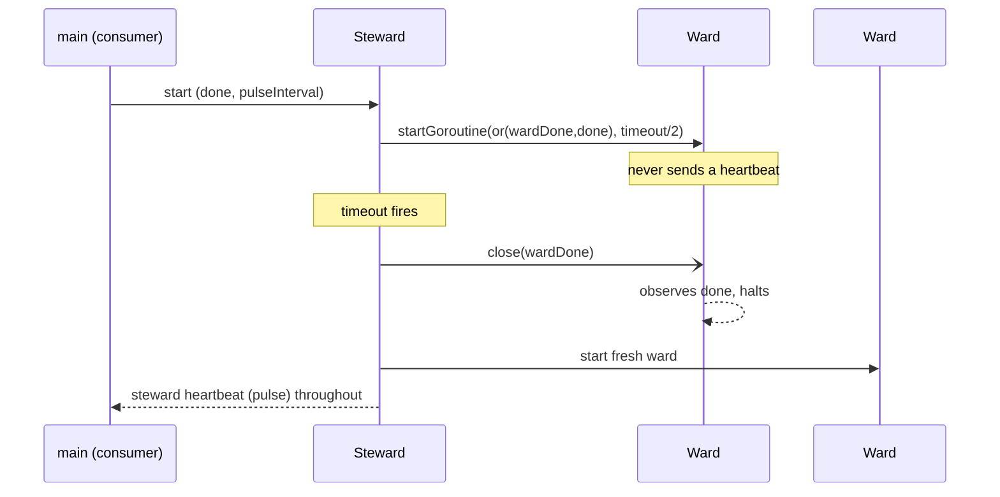
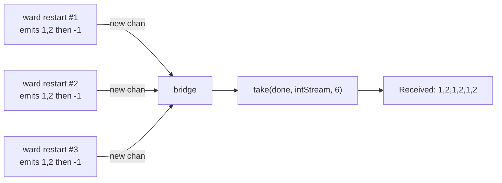

# Ch 5.7 — Healing Unhealthy Goroutines

> Book: *Concurrency in Go* (Katherine Cox-Buday, O'Reilly 2017) · Chapter 5: Concurrency at Scale · Pages ~188–194
> ⬅️ Prev: [Multi-Tier Rate Limiting](06-multi-tier-rate-limiting.md) · ➡️ Next: [Chapter 6 — Goroutines and the Go Runtime](../ch06-goroutines-and-the-go-runtime/README.md) · 🏠 [Book index](README.md)

## 🎯 In One Paragraph

Long-lived processes (daemons) typically run long-lived goroutines that block waiting for data, wake, work, and pass it on. Those goroutines often depend on resources you don't fully control (a flaky web service, an ephemeral file), so it's easy for one to get **stuck in a bad state it can't recover from without external help**. By separation of concerns, a worker arguably *shouldn't* know how to heal itself — so we build a mechanism that monitors goroutine health and restarts them when they go bad. The book calls this **healing**, the monitor a **steward**, and the monitored goroutine a **ward** — exactly Erlang's supervisor/worker idea. The steward uses the **heartbeat pattern** to check liveness: it starts the ward (giving it a `done` channel that is the logical-OR of the steward's own `done` and a per-ward `wardDone`, plus a pulse interval of `timeout/2`), then watches for the ward's heartbeat. If no heartbeat arrives within `timeout`, it logs "ward unhealthy", closes `wardDone`, and starts a fresh ward — all while emitting *its own* heartbeat so the steward is itself monitorable (`newSteward` returns a `startGoroutineFn`, so stewards can supervise stewards). Because wards need arbitrary shapes, you wrap them in **closures** and use the **bridge-channel** pattern to present one uninterrupted stream to the consumer across restarts. The catch: a naively restarted ward starts from scratch, re-emitting earlier values — so if duplicates matter, make the ward **stateful** across restarts (or cap the number of restarts).

## 🧠 Key Concepts & Vocabulary

- **Healing**: Restarting a goroutine that has become unhealthy, so long-lived processes keep running.
- **Steward**: The logic that monitors a goroutine's health and restarts it when unhealthy (the "supervisor").
- **Ward**: The monitored goroutine (the "worker").
- **`startGoroutineFn`**: `func(done <-chan any, pulseInterval time.Duration) (heartbeat <-chan any)` — the shape of a monitorable, restartable goroutine. A steward both *takes* one and *returns* one.
- **Steward is monitorable**: `newSteward` returns a `startGoroutineFn`, so a steward can itself be supervised by another steward (supervision tree).
- **`wardDone` + logical-OR**: The steward makes a fresh `wardDone` per ward and passes `or(wardDone, done)` into it, so the ward halts if *either* the steward is halted or the steward wants to restart the ward.
- **`pulseInterval = timeout/2`**: Same slack idea as heartbeats — give the ward an extra tick before the steward declares it dead.
- **Monitor loop**: Each iteration resets `timeout := time.After(timeout)`; a received ward heartbeat `continue`s the loop (healthy); a `timeoutSignal` triggers restart; `done` ends the steward. The steward also pulses its own heartbeat.
- **Closures for arbitrary wards**: Wrap a ward's parameters/return channels in a closure so one generic steward can drive any ward shape without regeneration.
- **Bridge-channel across restarts**: Because each restart creates a new internal channel, use the bridge pattern (channel of channels) to present a single, uninterrupted stream to the consumer.
- **Restart-from-scratch problem**: A fresh ward re-runs from its initial state (re-emitting early values). Fix by making the ward **stateful** across restarts, or by capping restarts.
- **Liveness vs. useful work**: If a ward can livelock, the heartbeat should carry evidence of *useful work*, not just "I'm up."

## 📚 Deep Dive

### The steward

```go
type startGoroutineFn func(
    done <-chan any,
    pulseInterval time.Duration,
) (heartbeat <-chan any)

func newSteward(timeout time.Duration, startGoroutine startGoroutineFn) startGoroutineFn {
    return func(done <-chan any, pulseInterval time.Duration) <-chan any {
        heartbeat := make(chan any)
        go func() {
            defer close(heartbeat)

            var wardDone chan any
            var wardHeartbeat <-chan any
            startWard := func() {
                wardDone = make(chan any)                               // fresh halt channel
                wardHeartbeat = startGoroutine(or(wardDone, done), timeout/2) // OR both dones
            }
            startWard()
            pulse := time.Tick(pulseInterval)

        monitorLoop:
            for {
                timeoutSignal := time.After(timeout) // reset each loop
                for {
                    select {
                    case <-pulse: // steward emits its OWN heartbeat (it is monitorable)
                        select {
                        case heartbeat <- struct{}{}:
                        default:
                        }
                    case <-wardHeartbeat: // ward is alive
                        continue monitorLoop
                    case <-timeoutSignal: // ward went silent -> heal it
                        log.Println("steward: ward unhealthy; restarting")
                        close(wardDone)
                        startWard()
                        continue monitorLoop
                    case <-done: // steward itself halted
                        return
                    }
                }
            }
        }()
        return heartbeat
    }
}
```





```mermaid
stateDiagram-v2
    [*] --> StartWard
    StartWard --> Monitoring: ward started, timeout armed
    Monitoring --> Monitoring: ward heartbeat (continue)
    Monitoring --> Monitoring: pulse (steward emits own heartbeat)
    Monitoring --> Restart: timeout (no ward heartbeat)
    Restart --> StartWard: close(wardDone); start fresh ward
    Monitoring --> [*]: steward done
```

### Running it against an irresponsible ward

The ward prints a greeting and only waits to be canceled — it never pulses, so it's always "unhealthy."

```go
doWork := func(done <-chan any, _ time.Duration) <-chan any {
    log.Println("ward: Hello, I'm irresponsible!")
    go func() {
        <-done
        log.Println("ward: I am halting.")
    }()
    return nil // no heartbeat -> steward will keep restarting it
}
doWorkWithSteward := newSteward(4*time.Second, doWork)

done := make(chan any)
time.AfterFunc(9*time.Second, func() {
    log.Println("main: halting steward and ward.")
    close(done)
})
for range doWorkWithSteward(done, 4*time.Second) {
}
log.Println("Done")
```

**Verified output** (9-second run; healed every ~4 s):

```text
20:26:52 ward: Hello, I'm irresponsible!
20:26:56 steward: ward unhealthy; restarting
20:26:56 ward: Hello, I'm irresponsible!
20:26:56 ward: I am halting.
20:27:00 steward: ward unhealthy; restarting
20:27:00 ward: Hello, I'm irresponsible!
20:27:00 ward: I am halting.
20:27:01 main: halting steward and ward.
20:27:01 Done
```

### Complete runnable program

This self-contained program bundles the `or` helper, the `newSteward` monitor, and an irresponsible ward that never heartbeats, so you can run the heal loop end to end. Verified with `go run`:

```go
package main

import (
	"log"
	"os"
	"time"
)

// or returns a channel that closes when any of its inputs closes (fan-in of dones).
func or(channels ...<-chan any) <-chan any {
	switch len(channels) {
	case 0:
		return nil
	case 1:
		return channels[0]
	}
	orDone := make(chan any)
	go func() {
		defer close(orDone)
		switch len(channels) {
		case 2:
			select {
			case <-channels[0]:
			case <-channels[1]:
			}
		default:
			select {
			case <-channels[0]:
			case <-channels[1]:
			case <-channels[2]:
			case <-or(append(channels[3:], orDone)...):
			}
		}
	}()
	return orDone
}

type startGoroutineFn func(done <-chan any, pulseInterval time.Duration) (heartbeat <-chan any)

func newSteward(timeout time.Duration, startGoroutine startGoroutineFn) startGoroutineFn {
	return func(done <-chan any, pulseInterval time.Duration) <-chan any {
		heartbeat := make(chan any)
		go func() {
			defer close(heartbeat)

			var wardDone chan any
			var wardHeartbeat <-chan any
			startWard := func() {
				wardDone = make(chan any)
				wardHeartbeat = startGoroutine(or(wardDone, done), timeout/2)
			}
			startWard()
			pulse := time.Tick(pulseInterval)

		monitorLoop:
			for {
				timeoutSignal := time.After(timeout)
				for {
					select {
					case <-pulse:
						select {
						case heartbeat <- struct{}{}:
						default:
						}
					case <-wardHeartbeat:
						continue monitorLoop
					case <-timeoutSignal:
						log.Println("steward: ward unhealthy; restarting")
						close(wardDone)
						startWard()
						continue monitorLoop
					case <-done:
						return
					}
				}
			}
		}()
		return heartbeat
	}
}

func main() {
	log.SetOutput(os.Stdout)
	log.SetFlags(log.Ltime | log.LUTC)

	// An irresponsible ward: greets, waits to be canceled, never heartbeats.
	doWork := func(done <-chan any, _ time.Duration) <-chan any {
		log.Println("ward: Hello, I'm irresponsible!")
		go func() {
			<-done
			log.Println("ward: I am halting.")
		}()
		return nil
	}

	doWorkWithSteward := newSteward(4*time.Second, doWork)

	done := make(chan any)
	time.AfterFunc(9*time.Second, func() {
		log.Println("main: halting steward and ward.")
		close(done)
	})

	for range doWorkWithSteward(done, 4*time.Second) {
	}
	log.Println("Done")
}
```

Over a 9-second run the steward heals the silent ward roughly every 4 seconds, matching the verified output above.


A ward usually needs parameters and return channels. Wrap it in a closure; because each restart makes a new internal `intStream`, use the **bridge** pattern to flatten a *channel of channels* into one continuous stream for the consumer.

```go
doWorkFn := func(done <-chan any, intList ...int) (startGoroutineFn, <-chan any) {
    intChanStream := make(chan (<-chan any))
    intStream := bridge(done, intChanStream) // one uninterrupted stream across restarts
    doWork := func(done <-chan any, pulseInterval time.Duration) <-chan any {
        intStream := make(chan any) // fresh per ward instance
        heartbeat := make(chan any)
        go func() {
            defer close(intStream)
            select {
            case intChanStream <- intStream: // tell bridge about the new channel
            case <-done:
                return
            }
            pulse := time.Tick(pulseInterval)
            for {
            valueLoop:
                for _, intVal := range intList {
                    if intVal < 0 { // simulate an unhealthy ward
                        log.Printf("negative value: %v\n", intVal)
                        return
                    }
                    for {
                        select {
                        case <-pulse:
                            select {
                            case heartbeat <- struct{}{}:
                            default:
                            }
                        case intStream <- intVal:
                            continue valueLoop
                        case <-done:
                            return
                        }
                    }
                }
            }
        }()
        return heartbeat
    }
    return doWork, intStream
}
```

Driver:

```go
done := make(chan any)
defer close(done)

doWork, intStream := doWorkFn(done, 1, 2, -1, 3, 4, 5)
doWorkWithSteward := newSteward(1*time.Millisecond, doWork) // expect quick failures
doWorkWithSteward(done, 1*time.Hour)

for intVal := range take(done, intStream, 6) {
    fmt.Printf("Received: %v\n", intVal)
}
```

**Verified output:**

```text
Received: 1
20:27:01 negative value: -1
Received: 2
20:27:01 steward: ward unhealthy; restarting
Received: 1
20:27:01 negative value: -1
Received: 2
20:27:01 steward: ward unhealthy; restarting
Received: 1
20:27:01 negative value: -1
Received: 2
```



### The restart-from-scratch gotcha, and the fix

We only ever receive `1` and `2` because each new ward starts over from the beginning of `intList` and dies again on `-1`. If duplicates matter, make the generator **stateful** across restarts by consuming the slice as you go:

```go
// before (restarts replay 1, 2 forever):
valueLoop:
for _, intVal := range intList {
    // ...
}

// after (survives across restarts by advancing intList):
valueLoop:
for {
    intVal := intList[0]
    intList = intList[1:]
    // ...
}
```

This preserves progress between restarts — though here it would remain stuck on the invalid `-1`, so the ward keeps failing. Another option is a steward that **gives up after N failures** (mirroring Erlang's max-restart-intensity).

## ⚠️ Pitfalls & Gotchas

- **Duplicate values after restart.** A fresh ward replays its initial state. Make it stateful across restarts, or accept/dedupe downstream, if duplicates matter.
- **Infinite restart of a deterministic failure.** If the ward always fails on the same input (`-1`), the steward restarts forever. Cap restarts (give-up-after-N), like Erlang's restart intensity.
- **Liveness ≠ usefulness.** For livelock-prone wards, a bare "I'm up" heartbeat is misleading; carry evidence of actual progress (e.g. a counter) so the steward can detect a stuck-but-alive ward.
- **Forgetting the logical-OR of done channels.** The ward must stop on *either* the steward's `done` or its own `wardDone`; pass `or(wardDone, done)`, or a restart won't actually halt the old ward.
- **Timeout too tight relative to pulse.** Use `pulseInterval = timeout/2` so a healthy-but-slightly-slow ward isn't killed spuriously.
- **Not bridging across restarts.** Each ward instance uses a new channel; without the bridge pattern the consumer would see the stream break on every restart.
- **`time.Tick` leak.** As in the heartbeat section, `time.Tick` can't be stopped; prefer `time.NewTicker`/`Stop` for production stewards and wards.

## 🆕 Modern Go Notes

> [!note] 🆕 Supervisor libraries and modern lifecycle tools
> The steward/ward pattern is Erlang/OTP supervision ("let it crash") in Go. In practice you'll often reach for a battle-tested library or a cleaner primitive:
> - **`github.com/thejerf/suture`** — Erlang-style supervisor *trees* for Go, with restart logic, backoff, and failure escalation. The production evolution of this chapter's steward.
> - **`github.com/oklog/run`** — `run.Group` orchestrates a set of goroutines as a unit: when the first actor exits, all others are interrupted. Great for `func main` lifecycle, though it does *not* auto-restart.
> - **`context`** everywhere: thread `context.Context` instead of bare `done`; use `context.AfterFunc` (1.21) for cleanup and `WithCancelCause`/`Cause` (1.20) to record *why* a ward was restarted.
> - **`sync.WaitGroup.Go` (1.25)** simplifies launching/reaping ward goroutines.
> - **`testing/synctest` (1.25)** makes steward timeout/restart tests deterministic and fast (no real `time.After` waits).
> - Pair with **`uber-go/goleak`** to prove that restarted wards don't leak.
> - Prefer carrying structured progress in the heartbeat (not just a pulse) so you detect livelock, and add **backoff** + a **restart cap** to avoid hot-looping on deterministic failures.

## 🧪 Try It Yourself

1. Add a restart cap: make the steward `return` after N consecutive timeouts and verify it stops after the cap.
2. Make `doWorkFn` stateful (consume `intList`) and confirm you no longer see repeated `1, 2`; observe it gets stuck on `-1`.
3. Replace the irresponsible ward with one that pulses normally and verify the steward never restarts it over a 9-second window.
4. Rewrite the steward to thread `context.Context`; record the restart cause with `context.WithCancelCause` and print `context.Cause`.
5. Swap in `thejerf/suture` for the hand-rolled steward and compare restart/backoff behavior.

## ✅ Self-Check Questions

<details><summary>What are a "steward" and a "ward", and which Erlang concept do they mirror?</summary>
The steward is the monitor that checks a goroutine's health and restarts it when unhealthy; the ward is the monitored goroutine. They mirror Erlang/OTP's supervisor (steward) and worker (ward) in a supervision tree.
</details>

<details><summary>Why does `newSteward` return a `startGoroutineFn`?</summary>
So the steward itself has the same monitorable shape as a ward — meaning a steward can be supervised by another steward, allowing supervision trees.
</details>

<details><summary>Why pass `or(wardDone, done)` into the ward instead of just `done`?</summary>
The ward must halt if *either* the steward is being shut down (`done`) or the steward wants to restart just this ward (`wardDone`). The logical-OR closes the ward's done when either source closes.
</details>

<details><summary>How does the steward decide a ward is unhealthy, and what does it do?</summary>
Each monitor-loop iteration arms `time.After(timeout)`. If a ward heartbeat arrives first, it `continue`s (healthy). If the timeout fires first (no heartbeat), it logs "ward unhealthy; restarting", closes `wardDone`, starts a fresh ward, and continues monitoring.
</details>

<details><summary>Why are closures and the bridge-channel pattern used for real wards?</summary>
Closures let one generic steward drive wards of arbitrary shape (by closing over their params/return channels). The bridge pattern flattens the channel-of-channels created across restarts into a single uninterrupted stream for the consumer.
</details>

<details><summary>Why does the stateful ward example only ever emit 1 and 2?</summary>
Because each restart re-runs the ward from scratch over `intList`, hitting the invalid `-1` after emitting 1 and 2, then dying and being restarted — so it replays 1, 2 each time unless made stateful across restarts.
</details>

<details><summary>If a ward can livelock (alive but doing no useful work), what should its heartbeat carry?</summary>
Evidence of useful work (e.g. a progress counter), not just a bare "I'm up" pulse, so the steward can detect a stuck-but-alive ward and restart it.
</details>

## 🔑 Key Takeaways

- Long-lived processes need a mechanism to **heal** goroutines stuck in unrecoverable states; separate that concern from the worker.
- A **steward** monitors a **ward** via heartbeats, restarting it on timeout; the steward is itself monitorable (returns a `startGoroutineFn`), enabling supervision trees.
- Pass `or(wardDone, done)` so restarts actually halt the old ward; use `pulseInterval = timeout/2` for slack.
- Use **closures** for arbitrary ward shapes and the **bridge-channel** to present one uninterrupted stream across restarts.
- Beware **restart-from-scratch duplicates**; make wards stateful or cap restarts; carry progress (not just liveness) when livelock is possible.
- Modern Go: `thejerf/suture` (supervisor trees), `oklog/run` (lifecycle), `context`, `synctest` for tests, `goleak` for leak checks.

## 🔗 References & Further Reading

📝 Blogs/articles:
- [Managing goroutine lifecycles with run.Group — Gopher Academy](https://blog.gopheracademy.com/advent-2017/run-group/) — orchestrating a set of goroutines as a unit (the lifecycle side of stewarding).
- [Building Resilient Systems with OTP Supervisors — Allan MacGregor](https://allanmacgregor.com/posts/building-resilient-systems-with-otp-supervisors) — the Erlang supervision philosophy this pattern borrows from.
- [How to Use Supervisors for Fault Tolerance — oneuptime](https://oneuptime.com/blog/post/2026-02-02-elixir-supervisors-fault-tolerance/view) — "let it crash" and restart strategies, directly analogous to steward/ward.
- [Learn You Some Erlang — Supervisors](https://learnyousomeerlang.com/supervisors) — restart intensity / max-restart concepts the book alludes to (cap restarts after N failures).

💻 GitHub:
- [thejerf/suture](https://github.com/thejerf/suture) — Erlang-style supervisor trees for Go; the production-grade version of the steward.
- [oklog/run](https://github.com/oklog/run) — universal mechanism to manage goroutine lifecycles as a group.
- [kat-co/concurrency-in-go-src](https://github.com/kat-co/concurrency-in-go-src) — the book's official steward/ward source.

📖 Official docs/specs:
- [Erlang Supervisor Behaviour](https://www.erlang.org/doc/design_principles/sup_princ) — the canonical supervision-tree design the chapter references.
- [context package — pkg.go.dev](https://pkg.go.dev/context) — `WithCancelCause`/`Cause` and `AfterFunc` for modern steward cancellation/cleanup.
- [testing/synctest — pkg.go.dev](https://pkg.go.dev/testing/synctest) — deterministic, fast testing of steward timeout/restart timing.
