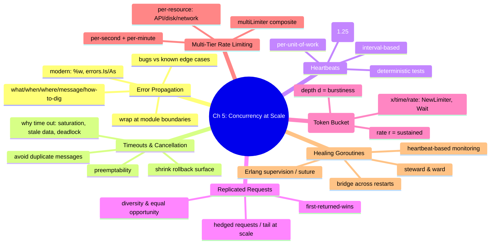
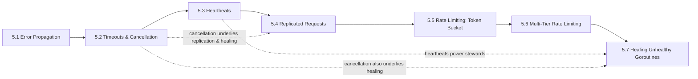

# Chapter 5 — Concurrency at Scale

> Book: *Concurrency in Go* (Katherine Cox-Buday, O'Reilly 2017) · Chapter 5 · Pages ~147–195
> ⬅️ Prev chapter: [Chapter 4 — Concurrency Patterns in Go](../ch04-concurrency-patterns-in-go/README.md) · ➡️ Next chapter: [Chapter 6 — Goroutines and the Go Runtime](../ch06-goroutines-and-the-go-runtime/README.md) · 🏠 [Book index](../README.md)

## Overview

Chapter 4 gave us the vocabulary of concurrency *patterns*; Chapter 5 composes those patterns into **practices for building large, composable, scalable systems** — the kinds that span multiple goroutines, processes, and even machines. The throughline is that Go's concurrency primitives *scale upward*: the same `done`-channel, `select`, and channel idioms become higher-order abstractions (heartbeats, stewards, aggregate rate limiters) without becoming cumbersome. The chapter walks a deliberate arc — first make failure *legible* (error propagation), then make work *stoppable* (timeouts and cancellation), then make liveness *observable* (heartbeats), then make responses *fast* (replicated requests), then make load *bounded* (token-bucket and multi-tier rate limiting), and finally make the system *self-repairing* (healing unhealthy goroutines with steward/ward). Together these turn fragile concurrent code into systems you can reason about, test deterministically, and keep stable under real-world timing and failure.

## Chapter Mind Map

## Mini-Chapters

| # | Mini-chapter | One-line summary |
|---|---|---|
| 5.1 | [Error Propagation](01-error-propagation.md) | Design errors as first-class: carry what/where/when + a friendly message + a log ID; wrap at module boundaries so "bug vs. edge case" is explicit. |
| 5.2 | [Timeouts and Cancellation](02-timeouts-and-cancellation.md) | Time out for saturation/stale-data/deadlock; make goroutines preemptable, shrink rollback surface, and avoid duplicate downstream messages. |
| 5.3 | [Heartbeats](03-heartbeats.md) | Signal liveness on an interval or per work-unit; use heartbeats to detect dead/hung goroutines and to make concurrent tests deterministic. |
| 5.4 | [Replicated Requests](04-replicated-requests.md) | Fan out a request to diverse handlers, take the first response, cancel the losers — trading resources for lower latency and fault tolerance. |
| 5.5 | [Rate Limiting — Token Bucket](05-rate-limiting-token-bucket.md) | Bound access with a token bucket (`golang.org/x/time/rate`): depth `d` sets burstiness, rate `r` sets the sustained limit; `Wait(ctx)` for a token. |
| 5.6 | [Multi-Tier Rate Limiting](06-multi-tier-rate-limiting.md) | Compose limiters with a `multiLimiter`: per-second + per-minute tiers and per-resource (API/disk/network) limits, waiting the longest single wait. |
| 5.7 | [Healing Unhealthy Goroutines](07-healing-unhealthy-goroutines.md) | A steward monitors a ward via heartbeats and restarts it on timeout; closures + bridge channels keep a single stream across restarts (Erlang-style supervision). |

## How the pieces connect

- **Cancellation (5.2)** is the substrate for **replicated requests (5.4)** (cancel the losers) and **healing (5.7)** (halt an unhealthy ward).
- **Heartbeats (5.3)** are reused directly by the **steward (5.7)** to decide whether a ward is alive, and they solve the duplicate-message worry raised in **5.2**.
- **Rate limiting (5.5)** generalizes into **multi-tier limiting (5.6)** via the composite `multiLimiter`.
- **Error propagation (5.1)** underpins everything: in a system this complex, legible errors are what make the other practices debuggable.

## Verified Go programs

All complete programs were written to `/tmp/cig/verify/ch5/` and run with Go 1.27 (toolchain at `/home/sandyops/.local/bin/go`); the `x/time/rate` examples use a scratch module with `golang.org/x/time v0.16.0`.

| Program | Topic | Result |
|---|---|---|
| `errprop/` | boundary-wrapped `MyError` | prints crafted user message; full `%#v` log |
| `errprop_modern/` | `%w` + `errors.Is`/`As` | reaches wrapped `LowLevelErr` and `os.ErrNotExist` |
| `timeout/` | preemptable long calculation | worker preempts mid-calc on `close(done)` |
| `timeout_ctx/` | `context.WithTimeout` single-commit | commits once; second op hits deadline |
| `heartbeat_interval/` | interval heartbeat | ~2 pulses per result |
| `heartbeat_perunit/` | per-unit heartbeat | one pulse per result |
| `hbtest/` (`go test`) | deterministic heartbeat test | `PASS` (blocks on first heartbeat) |
| `replicated/` | first-returned-wins | fastest handler wins; losers canceled |
| `ratelimit/` | single token bucket | ~1 completion/second |
| `multilimit/` | multi-tier + per-resource | ~2/sec burst, then ~every 6 s |
| `steward/` | steward + irresponsible ward | heals every ~4 s |
| `steward_ward/` | steward + bridge ward | restarts on `-1`; emits 1,2 repeatedly |
