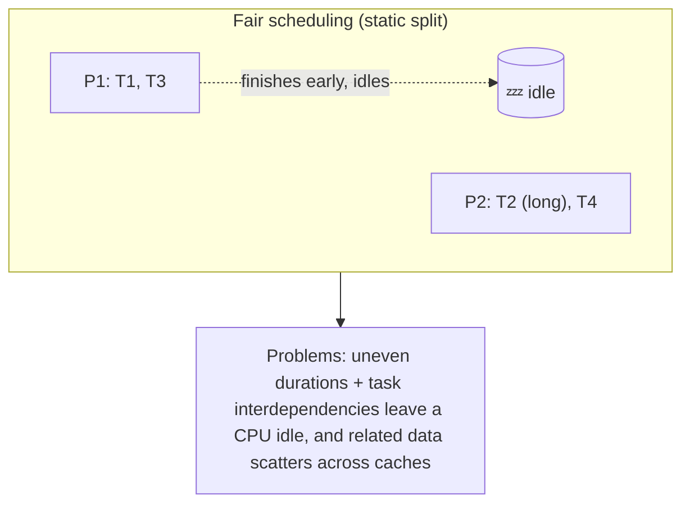
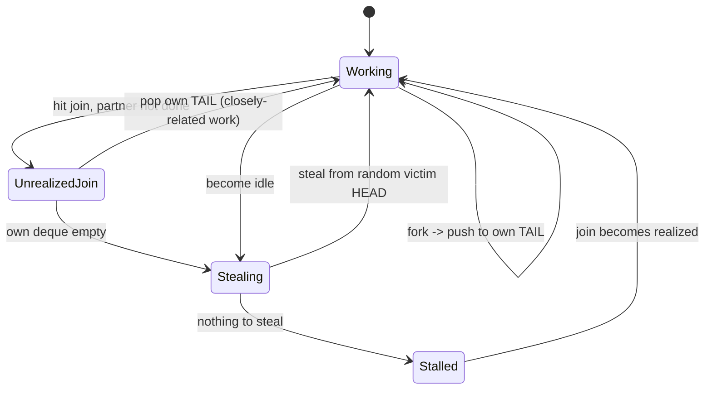
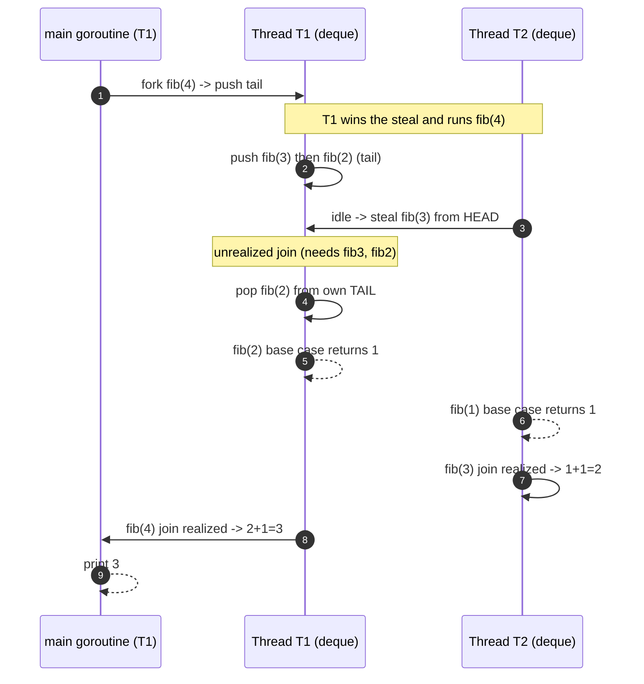
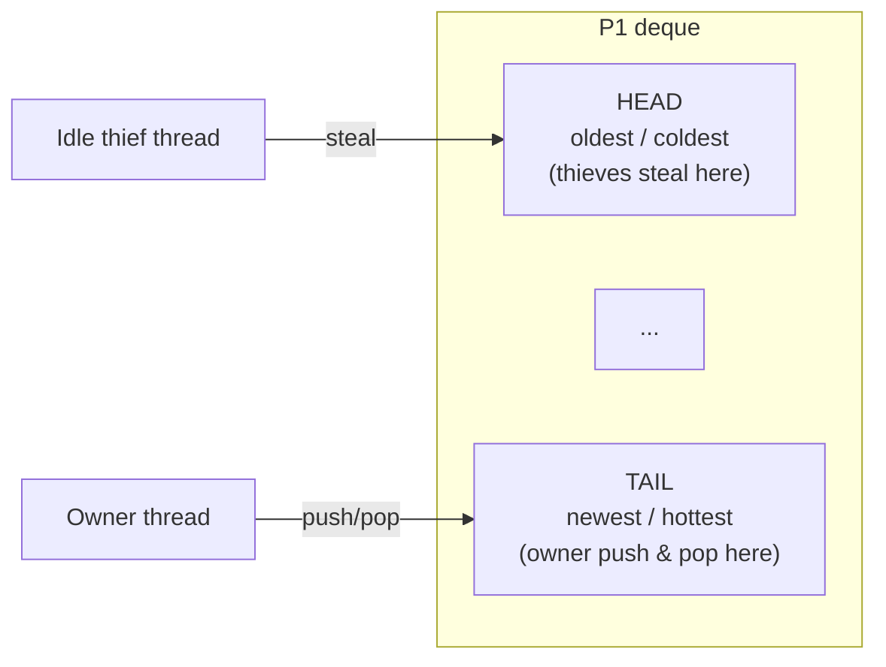

# Ch 6.1 — Work Stealing

> Book: *Concurrency in Go* (Katherine Cox-Buday, O'Reilly 2017) · Chapter 6: Goroutines and the Go Runtime · Pages ~197–204
> ⬅️ Prev: [Chapter 5 — Concurrency at Scale](../ch05-concurrency-at-scale/README.md) · ➡️ Next: [Stealing Tasks or Continuations?](02-stealing-tasks-or-continuations.md) · 🏠 [Book index](../README.md)

## 🎯 In One Paragraph

Go hides an enormous amount of sophistication behind the humble `go` keyword. The runtime multiplexes your goroutines onto a small pool of OS threads using a **work-stealing scheduler**. This mini-chapter builds the idea up from first principles: a naive *fair scheduling* strategy (split `x` tasks evenly across `n` processors) looks balanced but wrecks cache locality and leaves processors idle whenever tasks have uneven durations or interdependencies. A single central FIFO queue fixes idleness but reintroduces a contended, cache-hostile hotspot. The winning design gives each processor its own **double-ended queue (deque)**: a thread pushes/pops forked work at the *tail* of its own deque, and idle threads *steal* from the *head* of a random victim's deque. Walking a recursive Fibonacci program through this algorithm shows why stealing from the tail keeps the hottest, most-cache-resident work local and lets joins complete quickly.

## 🧠 Key Concepts & Vocabulary

- **Work stealing**: Scheduling strategy where each processor owns a queue of runnable work and idle processors "steal" work from busy ones instead of sitting idle.
- **Fair scheduling**: The naive baseline — distribute `x` tasks evenly as `x/n` per processor. Simple, but blind to task duration and dependencies.
- **Fork-join model**: Go's concurrency model. A **fork** is where a goroutine is started; a **join** is where goroutines re-synchronize (via channels or the `sync` package). Tasks are often dependent on one another.
- **Cache locality**: Keeping the data a processor needs in *its own* CPU cache. Shuffling related work across processors causes cache misses.
- **Centralized FIFO queue**: One shared queue all processors enqueue/dequeue from. Fixes idleness but becomes a contended critical section and a cache pingpong hotspot — fine for coarse-grained work, bad for fine-grained goroutines.
- **Deque (double-ended queue)**: A per-processor queue you can push/pop from both ends. The core data structure of distributed work stealing.
- **Tail vs. head**: The owning thread works its own deque's **tail** (LIFO for itself); thieves steal from the **head** (FIFO for them). This split is the whole trick.
- **Stalling join / unrealized join point**: A join whose partner goroutine hasn't finished yet. The thread can't proceed, so it looks for other work to do.
- **T / P / M**: In this section `T` (thread) ≈ `M` (OS thread) and the per-thread deque ≈ `P` (processor context). Full G/M/P nomenclature is introduced in the next mini-chapter.

## 📚 Deep Dive

### Why not just split the work evenly? (Fair scheduling)

Imagine `n` processors and `x` tasks. Fair scheduling hands each processor `x/n` tasks. It *looks* balanced, but two realities of a fork-join program break it:

1. **Uneven durations.** If task 2 takes longer than tasks 1 + 3 combined, the processor that owns tasks 1 and 3 finishes early and sits idle.

| Time       | P1       | P2  |
|------------|----------|-----|
| n          | T1       | T2  |
| n+a        | T3       | T2  |
| n+a+b      | (idle)   | T4  |

2. **Interdependencies.** If task 1 depends on the result of task 4 (which sits on P2), P1 blocks on the join and *cannot* opportunistically pull task 4 forward to unblock itself.

| Time         | P1          | P2      |
|--------------|-------------|---------|
| n            | T1          | T2      |
| n+a          | (blocked)   | T2      |
| n+a+b        | (blocked)   | T4      |
| n+a+b+c      | T1          | (idle)  |
| n+a+b+c+d    | T3          | (idle)  |

Both cases leave a processor idle — exactly what good scheduling must avoid.



### Attempt 2: one central FIFO queue

Dump all work into a single FIFO queue; each processor dequeues when it has capacity and blocks on joins. This **solves idleness** — no processor starves while work exists — but:

- The queue is a **centralized data structure under contention**. Every enqueue/dequeue enters and exits a critical section, which (as Chapter 1's "Memory Access Synchronization" argued) is expensive.
- **Cache locality gets worse**: the shared queue is loaded into every processor's cache on every operation.

Verdict: acceptable for *coarse-grained* operations, poor for goroutines, which are deliberately fine-grained.

### Attempt 3: distributed deques (the real design)

Give each processor its own thread **and** its own deque. This removes the central hotspot. But it raises new questions: if all forked work from P1 lands on P1's deque, how does P2 ever get work, and won't moving tasks between queues cause context-switch churn? The **work-stealing rules** answer this. Given a thread of execution:

1. **At a fork point**, push new work onto the **tail** of *this* thread's deque.
2. **If the thread is idle**, steal work from the **head** of *some random other* thread's deque.
3. **At an unrealized join point**, pop work off the **tail** of this thread's *own* deque (keep yourself busy with closely related work).
4. **If the thread's deque is empty**, either (a) stall at the join, or (b) steal from the head of a random thread's deque.



### The example program: recursive Fibonacci

The book drives the algorithm with a channel-per-goroutine Fibonacci. Each call forks a goroutine (a *task*) and returns a channel; receiving from that channel is the *join*.

```go
package main

import (
	"fmt"
	"runtime"
)

// fib returns a channel that will eventually yield the n-th Fibonacci number.
// Each call forks a goroutine; everything after the `go` call is the continuation.
// Joins happen via channel receives: <-fib(n-1) + <-fib(n-2).
func fib(n int) <-chan int {
	result := make(chan int)
	go func() {
		defer close(result)
		if n <= 2 {
			result <- 1
			return
		}
		result <- <-fib(n-1) + <-fib(n-2)
	}()
	return result
}

func main() {
	fmt.Printf("GOMAXPROCS = %d\n", runtime.GOMAXPROCS(0))
	for _, n := range []int{4, 10, 15} {
		fmt.Printf("fib(%d) = %d\n", n, <-fib(n))
	}
}
```

Verified output on this machine (16 logical CPUs):

```text
GOMAXPROCS = 16
fib(4) = 3
fib(10) = 55
fib(15) = 610
```

> ⚠️ This is a *pedagogical* Fibonacci: it spawns an exponential number of goroutines (`fib(n)` forks two more) and is intentionally wasteful. It illustrates the scheduler, not an efficient Fibonacci. Don't ship it.

### Walking `fib(4)` through task-stealing (two threads, T1 & T2)

The book flips between T1 and T2 for structure; in reality nothing is deterministic. The deque holds **tasks** (goroutines) in this first walkthrough. Key moments:

- `main` is scheduled on T1. Calling `fib(4)` pushes a goroutine onto T1's tail.
- T1 (winning the steal, by assumption) runs `fib(4)`, which — because addition evaluates left-to-right — pushes `fib(3)` then `fib(2)` onto its tail.
- Idle T2 steals `fib(3)` from the **head** of T1's deque. Crucially, `fib(2)` (pushed last, needed first) stays on T1.
- T1 reaches an unrealized join (needs `fib(3)` and `fib(2)` results) and pops `fib(2)` off its own tail to keep working.
- Both threads recurse to the base case (`n <= 2 → 1`), return results on channels, and joins unwind: `1+1=2` for `fib(3)`, then `2+1=3` for `fib(4)`, which the main goroutine finally prints.



### Why steal from the tail? Two implicit performance wins

The owning thread pushes and pops its **tail**; thieves take the **head**. The item on the tail has two valuable properties:

1. **It's the work most likely needed to complete the parent's join.** Finishing joins sooner means the program makes progress faster and holds fewer things in memory.
2. **It's the work most likely still in this CPU's cache.** It's what the thread touched most recently, so re-running it causes **fewer cache misses**.

Meanwhile thieves take the *oldest* work (head), which is least likely to be in the victim's hot cache and least likely to be its imminent next step — minimizing disruption to the victim.



## ⚠️ Pitfalls & Gotchas

- **Fair/static scheduling is a trap** for dependent, uneven work — it looks balanced but idles CPUs and scatters caches.
- **A single central queue** replaces idleness with lock contention and cache pingpong; only acceptable for coarse-grained work.
- **Don't confuse deque ends.** Owner works the tail; thieves take the head. Reversing that destroys the cache-locality benefit.
- The **recursive Fibonacci is a teaching device**, not production code — it forks O(φⁿ) goroutines.
- Work stealing is **nondeterministic**: which thread wins a steal varies run to run. Never rely on a particular interleaving.

## 🆕 Modern Go Notes

> 🆕 **`any` over `interface{}` (Go 1.18).** The book uses `interface{}` for the never-closed channel idiom. Modern Go prefers the `any` alias.

> 🆕 **The deque steals *half*, not one item.** Modern Go's `runtime` steals roughly **half** of a victim P's local run queue in one go (`runqsteal`/`runqgrab`), amortizing the cost of a steal. The conceptual "steal from the head" model in the book still holds.

> 🆕 **`GOMAXPROCS` is container-aware (Go 1.25).** The default number of per-P deques (`GOMAXPROCS`) now respects a Linux cgroup CPU quota, not just `runtime.NumCPU()`. See the next mini-chapter for details.

## 🧪 Try It Yourself

1. Run the Fibonacci program with `GOMAXPROCS=1` vs `GOMAXPROCS=8`:
   ```bash
   GOMAXPROCS=1 go run .
   GOMAXPROCS=8 go run .
   ```
   Observe that the *result* is identical — the scheduler is transparent.
2. Set `GODEBUG=schedtrace=1000` and run a longer `fib(25)`; watch per-P run queue lengths change as work is stolen.
3. Modify `fib` to count how many goroutines it spawns for `fib(10)`. Confirm the exponential blowup that makes this a *bad* real algorithm but a *good* scheduler demo.

## ✅ Self-Check Questions

<details><summary>Why does naive fair scheduling leave processors idle even when total work is balanced?</summary>
Because tasks have uneven durations and interdependencies. A static split can't rebalance when one processor's tasks finish early or when a task blocks waiting on a result owned by another processor.
</details>

<details><summary>What problem does a single central FIFO queue solve, and what two problems does it create?</summary>
It solves processor idleness (any free processor grabs the next task). It creates (1) lock contention on a centralized critical section and (2) worse cache locality, since the shared queue is loaded into every processor's cache on each operation.
</details>

<details><summary>In the distributed-deque algorithm, which end does the owning thread use and which end do thieves use?</summary>
The owning thread pushes and pops its own deque's **tail**; idle thieves steal from the **head** of a random victim's deque.
</details>

<details><summary>Give the two reasons stealing from the tail benefits the owner.</summary>
(1) The tail holds the work most likely needed to complete the parent's join, so joins finish faster and less state is held in memory. (2) The tail is the most recently touched work, so it's most likely still in the CPU cache — fewer cache misses.
</details>

<details><summary>What is an "unrealized join point" and what does a thread do when it hits one?</summary>
A join whose partner goroutine hasn't finished yet. Rather than stall, the thread pops work off the tail of its own deque (closely related work) to stay productive; if its deque is empty, it stalls or steals from another thread's head.
</details>

<details><summary>Why is the recursive channel-based Fibonacci a poor production algorithm?</summary>
Each call forks two more goroutines, giving exponential goroutine growth (O(φⁿ)) and massive channel/scheduling overhead. It's only useful to illustrate the scheduler.
</details>

## 🔑 Key Takeaways

- Go multiplexes goroutines onto OS threads with a **work-stealing scheduler**, exposed to you only as the `go` keyword.
- **Fair scheduling** and a **central FIFO queue** are both flawed; **per-processor deques with stealing** win.
- Owner uses the **tail** (hot, cache-resident, join-critical work); thieves use the **head** (cold, least-disruptive work).
- The algorithm follows four rules around fork points, idleness, unrealized joins, and empty deques.
- Work stealing is **nondeterministic** and automatically balances uneven, interdependent fork-join workloads.

## 🔗 References & Further Reading

### 📝 Blogs / articles / talks
- [Scheduling In Go: Part I — OS Scheduler (Ardan Labs / Bill Kennedy)](https://www.ardanlabs.com/blog/2018/08/scheduling-in-go-part1.html) — the canonical multi-part deep dive on how the Go scheduler layers on the OS scheduler.
- [Go's Goroutine Scheduler Internals: The M:N Model, Work Stealing, and GOMAXPROCS Myths](https://www.javacodegeeks.com/2026/10/gos-goroutine-scheduler-internals-the-mn-model-work-stealing-and-the-gomaxprocs-myths-that-wont-die.html) — modern walkthrough of G/M/P and the stealing algorithm.
- [Understanding the Go Scheduler (Medium, Sanil Khurana)](https://medium.com/@sanilkhurana7/understanding-the-go-scheduler-and-looking-at-how-it-works-e431a6daacf) — approachable illustrated explanation of run queues and stealing.

### 💻 GitHub
- [golang/go src/runtime/proc.go](https://github.com/golang/go/blob/master/src/runtime/proc.go) — the scheduler itself: `runqsteal`, `runqgrab`, `findrunnable`, `stealWork`.
- [kat-co/concurrency-in-go-src](https://github.com/kat-co/concurrency-in-go-src) — the book's official source code, including the Fibonacci example.

### 📖 Official docs / specs
- [Scalable Go Scheduler Design Doc (Dmitry Vyukov)](https://docs.google.com/document/d/1TTj4T2JO42uD5ID9e89oa0sLKhJYD0Y_kqxDv3I3XMw) — the original design doc that introduced the P (context) and work-stealing scheduler.
- [Go Wiki: Debugging performance issues in Go programs](https://go.dev/wiki/Performance) — covers `GODEBUG=schedtrace` and runtime scheduling diagnostics.
- [runtime package — `GOMAXPROCS`, scheduler env vars (pkg.go.dev)](https://pkg.go.dev/runtime) — the official API surface the scheduler exposes to developers.
