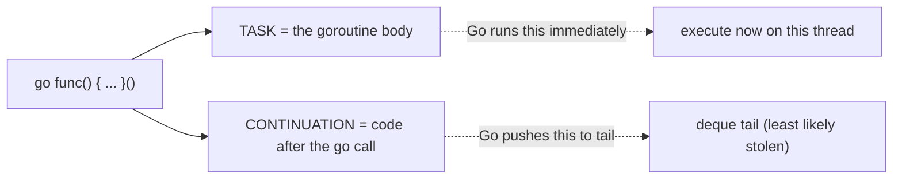
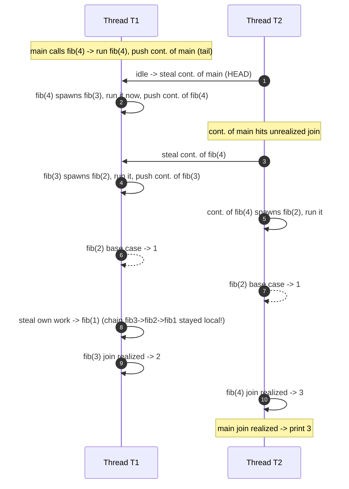
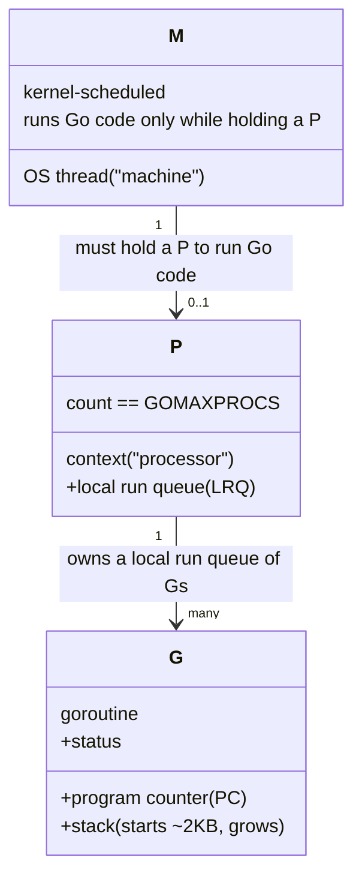
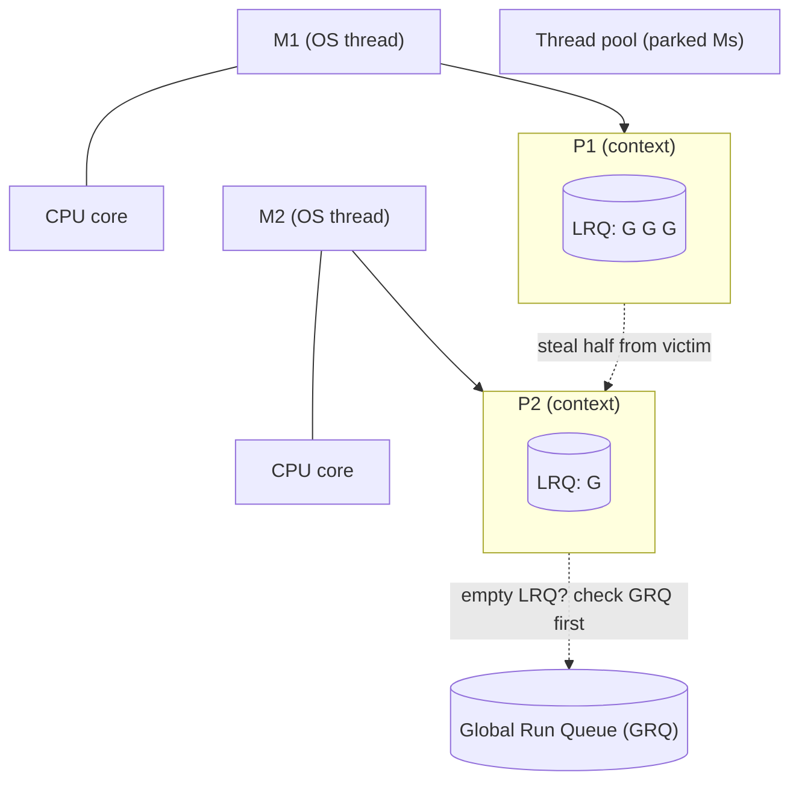
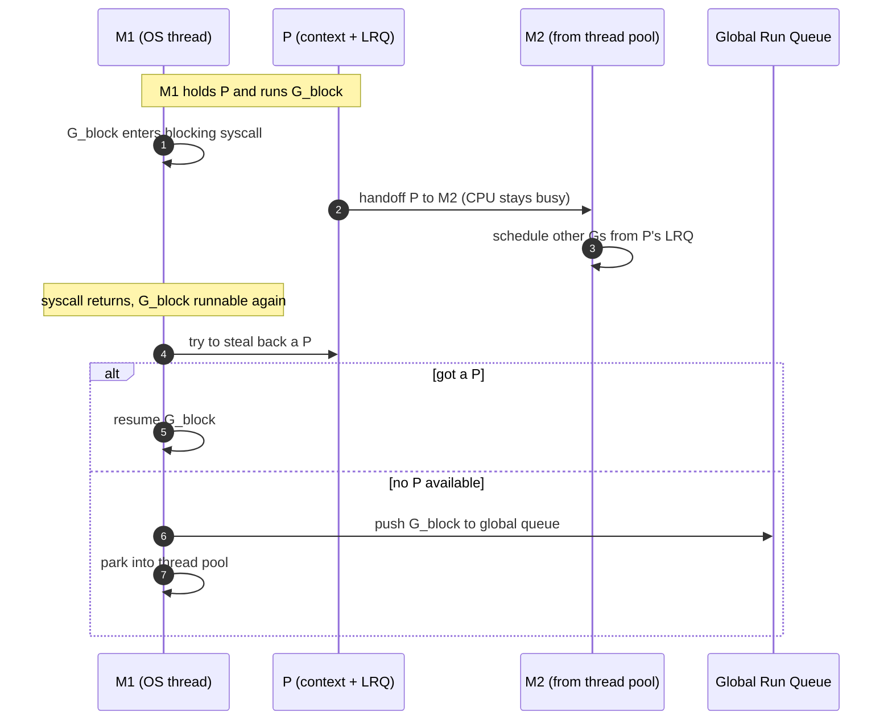
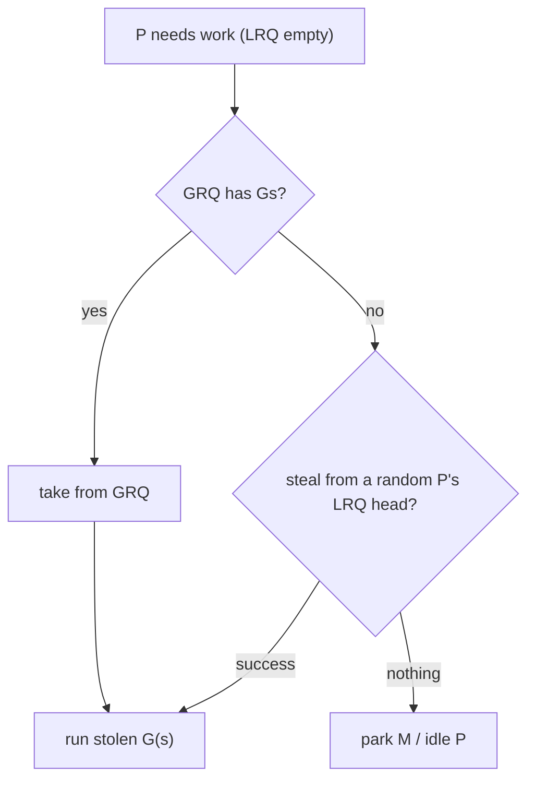
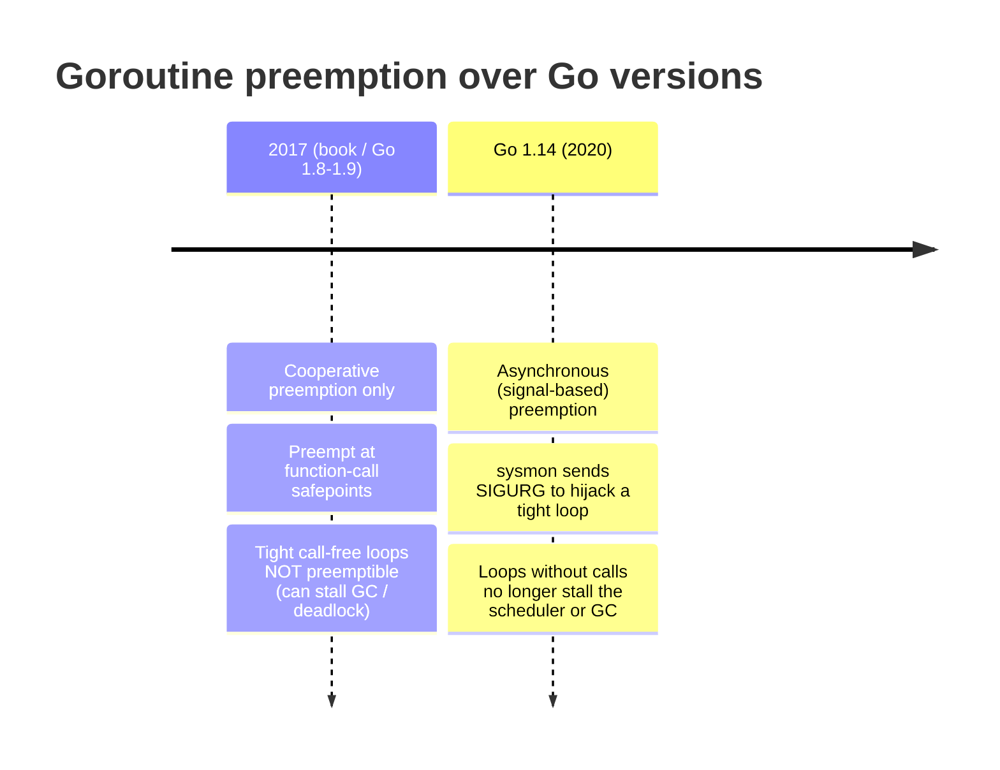

# Ch 6.2 — Stealing Tasks or Continuations? (plus the G/M/P model)

> Book: *Concurrency in Go* (Katherine Cox-Buday, O'Reilly 2017) · Chapter 6: Goroutines and the Go Runtime · Pages ~204–212
> ⬅️ Prev: [Work Stealing](01-work-stealing.md) · ➡️ Next: [Presenting All of This to the Developer](03-presenting-to-the-developer.md) · 🏠 [Book index](../README.md)

## 🎯 In One Paragraph

The previous mini-chapter glossed over *what* gets enqueued and stolen. Under a fork-join model there are two choices: **tasks** (the goroutine/function body) or **continuations** (everything after the `go` call). The book argues — and Go implements — that stealing **continuations** is theoretically superior: it bounds queue size, executes serially like plain function calls, and makes joins **non-stalling** (stalls happen on *idle* threads rather than busy ones). Because continuation stealing needs compiler support, library-only schedulers in other languages are stuck with "child"/task stealing; Go owns its compiler, so it can do it. This mini-chapter then switches to the runtime's real vocabulary — **G** (goroutine), **M** (OS thread / machine), **P** (context / processor) — and layers on the optimizations the abstract model omits: a thread pool, the guarantee of enough Ms to host every P, the **global run queue**, how a blocked **syscall hands the P off** to another M, and goroutine **preemption** (plus the one case the 2017 book said couldn't be preempted — since fixed by Go 1.14).

## 🧠 Key Concepts & Vocabulary

- **Task**: In Go, the goroutine itself — the function body you launched with `go`.
- **Continuation**: Everything *after* the `go func()` call — the code the calling goroutine runs next.
- **Task stealing (a.k.a. child stealing)**: Enqueue/steal the spawned goroutine. The default for library-based schedulers.
- **Continuation stealing**: Enqueue/steal the continuation; immediately start executing the newly spawned goroutine. Go's choice.
- **Stalling join**: A join where the thread pauses and goes looking for work because the partner isn't done. The question is *how often* and *on which threads* stalls happen.
- **G**: A goroutine — specifically its *current state*, most notably its program counter (PC). Storing the PC lets a G represent a continuation.
- **M (machine)**: An OS thread. The thing the kernel actually schedules onto a core.
- **P (processor / context)**: A scheduling context holding a **local run queue (LRQ)**. `GOMAXPROCS` sets how many Ps exist. An M must hold a P to run Go code.
- **Local run queue (LRQ)**: The per-P deque of runnable Gs (the book's "work deque").
- **Global run queue (GRQ)**: A runtime-wide queue of Gs not tied to any P — used when handoffs can't reattach a context. Periodically checked to prevent starvation.
- **Thread pool**: Parked Ms the runtime keeps for reuse (e.g., after a blocked thread wakes up).
- **Handoff**: When a G blocks in a syscall, its P is detached from the blocked M and handed to another (possibly new) M so it can keep scheduling Gs.
- **Preemption**: The runtime forcibly pausing a goroutine so others can run. In 2017 this happened at function-call boundaries; modern Go also preempts asynchronously via signals.

## 📚 Deep Dive

### Tasks vs. continuations in the Fibonacci program

```go
var fib func(n int) <-chan int
fib = func(n int) <-chan int {
	result := make(chan int)
	go func() {              // <-- the goroutine body is the TASK
		defer close(result)
		if n <= 2 {
			result <- 1
			return
		}
		result <- <-fib(n-1) + <-fib(n-2)
	}()
	return result            // <-- everything here onward is the CONTINUATION
}
fmt.Printf("fib(4) = %d", <-fib(4))
```

- **In Go, goroutines are tasks.**
- **Everything after a goroutine is called is the continuation.**

The first walkthrough (previous mini-chapter) enqueued *tasks*. That's intuitive — a goroutine is a tidy bundle of work — but it is **not** how Go actually works. Go's work-stealing algorithm enqueues and steals **continuations**.



### Why continuation stealing wins

When you write `go f()`, two things are *very likely*:
1. You actually want `f` to run.
2. The continuation will eventually want to **join** with `f`, often *before* `f` finishes.

So the smart move is: **immediately start running the spawned goroutine** and **push the continuation onto the tail** of the deque. Because thieves steal from the *head*, your continuation is *least likely* to be stolen — so when the goroutine finishes you just pick the continuation back up, avoiding a stall. This makes a forked task behave like a plain function call: jump into the goroutine, then return to the continuation afterward. On a single thread this is exactly what happens — **goroutines degrade to ordinary function calls**.

### Walking `fib(4)` with continuation stealing (T1 & T2)

Conventions: an enqueued continuation is `cont. of X`; when dequeued it becomes the next `fib` invocation.



The highlight: the call chain `fib(3) → fib(2) → fib(1)` all ran **serially on T1**, exactly as a sequence of function calls would — the cache-locality payoff of continuation stealing.

### The numbers: continuation vs. task stealing

| Statistic            | Continuation stealing      | Task stealing            |
|----------------------|----------------------------|--------------------------|
| # Steps              | 14                         | 15                       |
| Max deque length     | 2                          | 2                        |
| # Stalled joins      | 2 (all on **idle** threads)| 3 (all on **busy** threads)|
| Size of call stack   | 2                          | 3                        |

Stalls landing on *idle* threads are nearly free; stalls on *busy* threads waste useful capacity. Extrapolated to large programs, the gap grows. And the theoretical comparison:

| Property          | Continuation | Child (task) |
|-------------------|--------------|--------------|
| Queue size        | Bounded      | Unbounded    |
| Order of execution| Serial       | Out of order |
| Join point        | Non-stalling | Stalling     |

> "Stealing continuations are considered to be theoretically superior to stealing tasks." — *Concurrency in Go* (paraphrased). The catch: continuation stealing **needs compiler support**, which is why library schedulers settle for task/child stealing. Go has its own compiler, so it does continuation stealing.

### Single-threaded degeneracy

Run the continuation-stealing walkthrough with **one** thread and the sequence is identical to ordinary recursive function calls — `fib(4)` calls `fib(3)` calls `fib(2)`, unwinds, etc. That goroutines cost nothing extra on a single thread is a direct consequence of continuation stealing.

### The real vocabulary: G, M, P



- **G** = a goroutine, represented as its current state (notably PC) — this is what lets a G *be* a continuation.
- **M** = an OS thread.
- **P** = a context with a local run queue. `GOMAXPROCS` controls how many Ps exist (one per logical CPU by default).

Mapping back to the abstract model: **M ≈ T**, **P ≈ the work deque**, **G = goroutine/continuation**. Ms are started, host Ps, which schedule and host Gs.



### Optimization 1: more Ms than Ps, and a thread pool

There is always **at least enough Ms to host every P**. There can be *more* Ms than cores to handle GC, blocked goroutines, etc. Parked Ms live in a **thread pool** for reuse. This "spare threads" guarantee is what makes the next optimization possible.

### Optimization 2: syscall / blocking handoff

Consider a G that blocks on I/O or a syscall outside the runtime. The hosting M blocks too and can't run anything else. To keep CPUs busy, Go does this:

1. **Dissociate the P from the blocked M.** The P is handed to another (unblocked or newly woken) M.
2. The new M + P keep scheduling other Gs → CPUs stay active.
3. The **blocked G stays with the blocked M.**
4. When the G **unblocks**, its M tries to **steal back a P** from some other M to resume.
5. If it can't get a P, the M puts its G on the **global run queue (GRQ)**, then **parks itself** into the thread pool for future reuse.



### Optimization 3: the global run queue (GRQ)

The GRQ isn't part of the clean abstract model — it's an implementation detail forced by the handoff optimization. To stop Gs from starving in the GRQ, two extra steps join the algorithm:
- A P **periodically checks** the GRQ for waiting Gs.
- When a P's local queue is **empty**, it checks the **GRQ first**, *before* trying to steal from other Ps' LRQs.



> 🆕 Modern Go also checks the GRQ **periodically even when the LRQ is non-empty** (roughly every 61 schedule ticks) to guarantee fairness and prevent GRQ starvation under load. The precise interval is a runtime constant (`schedtick % 61`).

### Optimization 4: preemption

Beyond I/O and syscalls, the runtime can **preempt a goroutine during any function call**. This supports Go's preference for fine-grained concurrency: the runtime can reclaim a P at call boundaries and schedule other work.

**The one exception (as of the 2017 book):** a goroutine that does **no I/O, no syscalls, and no function calls** — e.g., a tight `for {}` compute loop — was **not preemptible**. Such goroutines could cause long GC pauses or even deadlocks. The author noted this was "a vanishingly small occurrence" the team was working to fix.



## ⚠️ Pitfalls & Gotchas

- **Don't equate "task" with what Go steals.** Go steals **continuations**, not goroutines, despite goroutines being the intuitive unit.
- **An M can't run Go code without a P.** If every P is busy, extra Ms sit in the thread pool.
- **The GRQ is a correctness/fairness escape hatch**, not a primary data structure. Relying on its ordering is wrong — it exists to prevent starvation after handoffs.
- **2017's "non-preemptible tight loop" footgun:** on old Go versions, a `for {}` with no calls could freeze the scheduler. If you ever read legacy advice about "insert `runtime.Gosched()` in hot loops," this is why — it's obsolete on Go 1.14+.
- **`GOMAXPROCS` ≠ thread count.** It bounds Ps (parallel Go execution contexts), not Ms. The runtime can create many more Ms for blocked syscalls.

## 🆕 Modern Go Notes

> 🆕 **Asynchronous preemption (Go 1.14).** The release notes state: *"Goroutines are now asynchronously preemptible. As a result, loops without function calls no longer potentially deadlock the scheduler or significantly delay garbage collection."* The `sysmon` monitor thread sends a `SIGURG` signal to hijack a running goroutine at a safe point. This directly fixes the book's "one notable exception." You can disable it with `GODEBUG=asyncpreemptoff=1` (rarely needed; some older kernels/debuggers want it off).

Verified on this machine (Go 1.27) — a tight, call-free, alloc-free hog loop on `GOMAXPROCS=1` does **not** starve a sibling goroutine:

```go
package main

import (
	"fmt"
	"runtime"
	"sync"
	"time"
)

func main() {
	runtime.GOMAXPROCS(1)
	var wg sync.WaitGroup
	var x uint64

	wg.Add(1)
	go func() { // tight, call-free loop: pre-1.14 this would starve the sibling
		defer wg.Done()
		deadline := time.Now().Add(150 * time.Millisecond)
		for time.Now().Before(deadline) {
			for i := 0; i < 1_000_000; i++ {
				x++
			}
		}
	}()

	ran := make(chan struct{})
	wg.Add(1)
	go func() {
		defer wg.Done()
		close(ran)
		fmt.Println("[cooperative goroutine] I got scheduled!")
	}()

	select {
	case <-ran:
		fmt.Println("async preemption let the second goroutine run")
	case <-time.After(2 * time.Second):
		fmt.Println("timed out (pre-1.14 behavior)")
	}
	wg.Wait()
	fmt.Printf("hog counter x=%d\n", x)
}
```

Verified output:

```text
[cooperative goroutine] I got scheduled!
async preemption let the second goroutine run
hog counter x=588000000
```

> 🆕 **Time-slice preemption (~10ms).** Since Go 1.14 each goroutine also gets a scheduling time slice (about 10ms); `sysmon` preempts goroutines that overrun it, giving OS-thread-like fairness.

> 🆕 **Container-aware `GOMAXPROCS` (Go 1.25).** Previously the default `GOMAXPROCS` was `runtime.NumCPU()` — the *host* core count — which caused CFS throttling and tail-latency cliffs in Kubernetes (a pod limited to 2 CPUs still set `GOMAXPROCS=32` on a 32-core node). Go 1.25's runtime reads the **cgroup CPU quota at startup** and sets the default to the *lower* of machine CPUs and the container limit. It also **re-reads the limit periodically** and updates `GOMAXPROCS` live if the quota changes. (Memory limits are still not auto-detected — set `GOMEMLIMIT` yourself.)

> 🆕 **Steal half.** Modern `runqsteal`/`runqgrab` steals ~half of a victim P's LRQ per steal, reducing steal frequency.

## 🧪 Try It Yourself

1. Observe handoff/scheduling with `GODEBUG=schedtrace=50 go run .` on a program that mixes a `time.Sleep` goroutine with CPU workers. Note `threads=` climbing past `gomaxprocs=` when a goroutine blocks.
2. Set `GOMAXPROCS=1` and run the preemption demo above with `GODEBUG=asyncpreemptoff=1`. Does the sibling still get scheduled? (It should, because the hog calls `time.Now()`, which is a safepoint — try replacing it with a pure arithmetic loop to see a harder case.)
3. In a container, run `GODEBUG=containermaxprocs=0 ./app` vs the default to compare `runtime.GOMAXPROCS(0)` under a CPU limit (Go 1.25+).

## ✅ Self-Check Questions

<details><summary>What is the difference between a "task" and a "continuation" in a Go fork-join program?</summary>
The task is the goroutine body launched with `go`. The continuation is all the code that runs *after* the `go` call in the spawning goroutine.
</details>

<details><summary>Why does Go steal continuations instead of tasks, and what does that require?</summary>
Continuation stealing gives bounded queue size, serial execution (like function calls), and non-stalling joins (stalls land on idle threads). It requires compiler support to capture and resume the continuation, which Go has because it controls its own compiler.
</details>

<details><summary>Define G, M, and P, and state which one GOMAXPROCS controls.</summary>
G = a goroutine (its state, including PC). M = an OS thread ("machine"). P = a scheduling context with a local run queue ("processor"). `GOMAXPROCS` controls the number of **P**s.
</details>

<details><summary>Walk through what happens to the P when a goroutine blocks in a syscall.</summary>
The P is detached from the blocked M and handed to another M so it keeps scheduling Gs. The blocked G stays with the blocked M. When the G unblocks, its M tries to steal back a P; if none is available, it puts the G on the global run queue and parks itself in the thread pool.
</details>

<details><summary>What is the global run queue for, and how is starvation on it prevented?</summary>
It holds Gs not attached to any P (e.g., after a handoff that couldn't reattach a context). Starvation is prevented because Ps periodically check the GRQ, and an empty-LRQ P checks the GRQ *before* stealing from other Ps.
</details>

<details><summary>Which goroutines were NOT preemptible in 2017, and how was that fixed?</summary>
Goroutines doing no I/O, no syscalls, and no function calls (e.g., a tight call-free loop) — they could stall GC or deadlock. Go 1.14 added asynchronous, signal-based (SIGURG) preemption via sysmon, so such loops are now preemptible.
</details>

<details><summary>Why can there be more Ms than Ps, and where do idle Ms go?</summary>
Extra Ms handle blocked syscalls, GC, and handoffs; the runtime guarantees at least enough Ms to host every P. Idle Ms park in the runtime's thread pool for reuse.
</details>

## 🔑 Key Takeaways

- Go steals **continuations**, not tasks — yielding bounded queues, serial (function-call-like) execution, and non-stalling joins.
- The real model is **G/M/P**: goroutines, OS threads, and contexts; `GOMAXPROCS` sets the number of Ps.
- An **M must hold a P** to run Go code; there are usually **more Ms than Ps** plus a parked **thread pool**.
- A blocking **syscall hands the P off** to another M; the **global run queue** catches Gs that can't reattach, and is polled to avoid starvation.
- **Preemption** happened at call boundaries in 2017; **Go 1.14** added async signal-based preemption, fixing the tight-loop footgun. **Go 1.25** made `GOMAXPROCS` container-aware.

## 🔗 References & Further Reading

### 📝 Blogs / articles / talks
- [Go Scheduler Preemption Under Goroutine Saturation (dev.to, Neeraj Singh)](https://dev.to/neeraj_singhi_golang/go-scheduler-preemption-under-goroutine-saturation-p-starvation-work-stealing-and-the-latency-324j) — P starvation, "steal half," and the latency cliff, with modern detail.
- [Go 1.14 Scheduler: Fully Non-Cooperative Preemption Explained (openillumi)](https://openillumi.com/en/en-go-114-non-cooperative-preemption-explained/) — how signal-based preemption replaced cooperative-only scheduling.
- [Signal-based preemptive scheduling in Go, from source (sobyte.net)](https://sobyte.net/post/2022-01/go-scheduling/) — source-level tour of how SIGURG preemption works.
- [Container-Aware GOMAXPROCS, New in Go 1.25 (Applied Go)](https://appliedgo.net/spotlight/go-1.25-container-aware-gomaxprocs/) — the cgroup-quota behavior with runnable examples.

### 💻 GitHub
- [golang/go src/runtime/proc.go](https://github.com/golang/go/blob/master/src/runtime/proc.go) — `schedule`, `findrunnable`, `handoffp`, `globrunqget`, `runqsteal`.
- [uber-go/automaxprocs](https://github.com/uber-go/automaxprocs) — the community library that inspired container-aware `GOMAXPROCS`; sets it from Linux cgroup CPU quota.
- [golang/go src/runtime/proc.go — `schedEnabled` / preemption path](https://github.com/golang/go/blob/master/src/runtime/preempt.go) — the asynchronous preemption implementation added in Go 1.14.

### 📖 Official docs / specs
- [Container-aware GOMAXPROCS (go.dev blog)](https://go.dev/blog/container-aware-gomaxprocs) — the official announcement and semantics of the Go 1.25 change.
- [Scalable Go Scheduler Design Doc (Dmitry Vyukov)](https://docs.google.com/document/d/1TTj4T2JO42uD5ID9e89oa0sLKhJYD0Y_kqxDv3I3XMw) and the [Go Preemptive Scheduler Design Doc](https://docs.google.com/document/d/1ETuA2IOmnaQ4j81AtTGT40Y4_Jr6_IDASEKg0t0dBR8/edit) — the P/context model and the preemption design.
