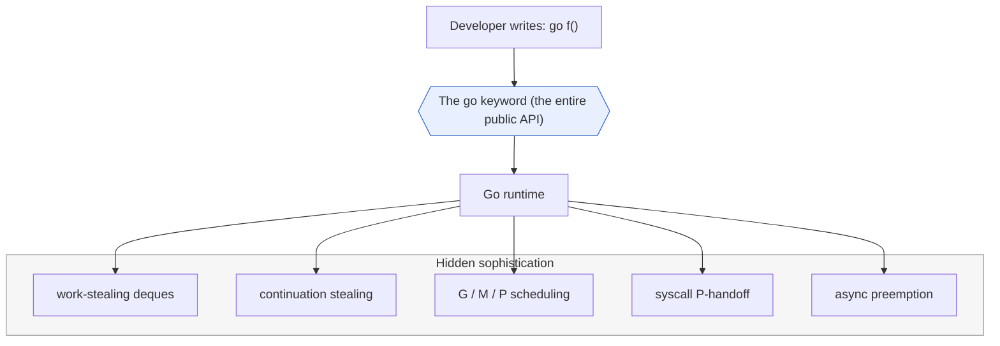
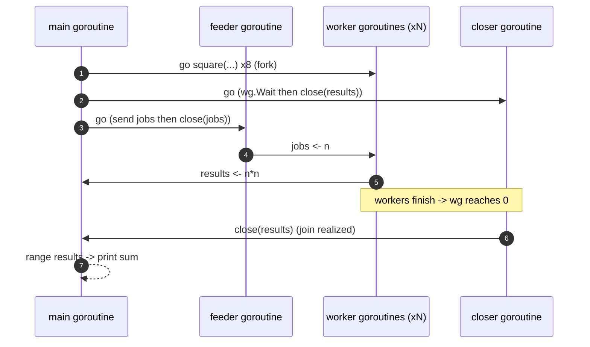
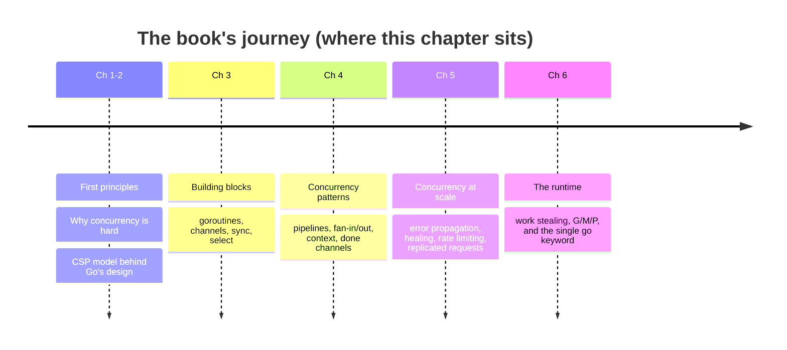

# Ch 6.3 — Presenting All of This to the Developer

> Book: *Concurrency in Go* (Katherine Cox-Buday, O'Reilly 2017) · Chapter 6: Goroutines and the Go Runtime · Pages ~212 (incl. Conclusion)
> ⬅️ Prev: [Stealing Tasks or Continuations?](02-stealing-tasks-or-continuations.md) · ➡️ Next: [Appendix — Tooling & Diagnostics](../appendix-tooling-and-diagnostics/README.md) · 🏠 [Book index](../README.md)

## 🎯 In One Paragraph

After two mini-chapters of deques, continuation stealing, syscall handoffs, and the G/M/P machinery, the payoff is almost comically small to *use*: the entire interface the developer sees is the `go` keyword. Put `go` in front of a function or closure and you've scheduled a task that the runtime will run in the most efficient way for the host machine — no new data structures, no scheduling API, no mental model beyond "functions." The book's thesis lands here: **scaling, efficiency, and simplicity** are what make goroutines intriguing. You get the sophistication of a work-stealing, continuation-based, preemptible M:N scheduler, but you *think* only in functions. This mini-chapter also closes the book's journey: first principles → building blocks → patterns → patterns-of-patterns → the runtime.

## 🧠 Key Concepts & Vocabulary

- **The `go` keyword**: The complete, sole developer-facing interface to the entire runtime scheduler. Prefix a function/closure call with `go` to fork a goroutine.
- **Facade / abstraction**: The runtime presents a simple surface (`go`) over deep complexity (work stealing, continuations, G/M/P, handoffs, preemption).
- **Thinking in primitives you already know**: You reason about goroutines as *functions*, not as a bespoke concurrency DSL.
- **Scaling, efficiency, simplicity**: The three properties the author credits for goroutines' appeal.

## 📚 Deep Dive

### The whole API is one keyword

Everything in Chapters 2–6 — the CSP modeling, the channels, the patterns, and the entire runtime — is driven by:

```go
go someFunction()        // fork a named function
go func() { /* ... */ }() // fork an anonymous closure
```

That's it. The runtime decides which M/P runs it, when to steal it, when to preempt it, and how to hand off its P on a syscall. As developers we keep thinking in **functions**, the primitive we already know. We don't learn a new scheduling model or new data structures.



### A complete runnable illustration

The point is that the *same* trivial syntax scales from one goroutine to thousands with no code change. Below, a worker pool, a fan-in, and the main goroutine are all just `go` + functions + channels — no scheduler knobs.

```go
package main

import (
	"fmt"
	"runtime"
	"sync"
)

// square reads jobs, squares them, and sends results — a plain function.
func square(id int, jobs <-chan int, results chan<- int, wg *sync.WaitGroup) {
	defer wg.Done()
	for n := range jobs {
		results <- n * n
	}
}

func main() {
	fmt.Printf("GOMAXPROCS = %d (the runtime picked this for us)\n", runtime.GOMAXPROCS(0))

	jobs := make(chan int)
	results := make(chan int)

	// Fork N workers. The ONLY concurrency syntax here is `go`.
	var wg sync.WaitGroup
	const workers = 8
	for i := 0; i < workers; i++ {
		wg.Add(1)
		go square(i, jobs, results, &wg) // same keyword, whether 1 or 10,000 workers
	}

	// Close results once all workers finish (a continuation that joins).
	go func() {
		wg.Wait()
		close(results)
	}()

	// Feed jobs in another goroutine so we can range results in main.
	go func() {
		for n := 1; n <= 20; n++ {
			jobs <- n
		}
		close(jobs)
	}()

	sum := 0
	for r := range results {
		sum += r
	}
	fmt.Printf("sum of squares 1..20 = %d\n", sum)
}
```

Verified output (order of worker execution is nondeterministic; the sum is stable):

```text
GOMAXPROCS = 16 (the runtime picked this for us)
sum of squares 1..20 = 2870
```

Every concurrency decision — which worker runs when, on which OS thread, how work is balanced — was made by the runtime. The developer only wrote `go` and channels.

### How the pieces talk at runtime



### Chapter Conclusion

The book closes Chapter 6 — and the whole book — by noting we've traversed the entire landscape of concurrency in Go: **first principles → basic usage → patterns → how the runtime does things**. The runtime chapter is optional knowledge for everyday coding, but understanding it explains *why* goroutines are cheap, *why* uneven workloads stay balanced, and *why* a blocked syscall doesn't freeze your service.



## ⚠️ Pitfalls & Gotchas

- **"Simple to write" ≠ "free."** `go f()` is syntactically trivial but each goroutine still consumes stack and scheduler state. Spawning unbounded goroutines (e.g., one per request with no limit) can exhaust memory — bound them with worker pools or semaphores.
- **You still own correctness.** The runtime schedules; it does **not** synchronize your shared memory. Data races are your responsibility (see the Appendix's race-detector mini-chapter).
- **No ordering guarantees.** The `go` keyword says *run this concurrently*, not *run this next* or *in this order*. Never assume goroutines start or finish in launch order.
- **Fire-and-forget leaks.** A `go f()` whose function blocks forever (e.g., on a channel nobody closes) is a goroutine leak the keyword happily lets you create.

## 🆕 Modern Go Notes

> 🆕 **`sync.WaitGroup.Go` (Go 1.25).** The fork+Add+Done boilerplate in the example can be shortened: `wg.Go(func() { square(...) })` increments the counter, runs the function in a new goroutine, and decrements on return — a small ergonomic win over `wg.Add(1); go func(){ defer wg.Done(); ... }()`.

> 🆕 **`errgroup` for forking with error handling.** `golang.org/x/sync/errgroup` wraps the `go`+WaitGroup pattern and propagates the first error plus cancellation — the idiomatic modern way to fork a bounded group of goroutines that can fail.

> 🆕 **Loop variable capture fixed (Go 1.22).** Pre-1.22, `for i := ...; { go func(){ use(i) }() }` captured a shared `i`. Since Go 1.22 each iteration has its own variable, so the classic "all goroutines print the last value" bug is gone. The example above sidesteps it anyway by passing `i` as an argument.

## 🧪 Try It Yourself

1. Rewrite the worker-pool example using `sync.WaitGroup.Go` (Go 1.25) and confirm identical output.
2. Change `workers` from 8 to 10,000. The code is unchanged except one constant — observe that the runtime still balances it (watch with `GODEBUG=schedtrace=1000`).
3. Convert the pool to `errgroup.Group` where one worker returns an error for a specific input; confirm the group cancels and reports the first error.

## ✅ Self-Check Questions

<details><summary>What is the complete developer-facing interface to Go's scheduler?</summary>
The single `go` keyword, placed before a function or closure call. There is no additional scheduling API to learn.
</details>

<details><summary>Which three properties does the author credit for making goroutines intriguing?</summary>
Scaling, efficiency, and simplicity.
</details>

<details><summary>Does the `go` keyword provide any ordering or synchronization guarantees?</summary>
No. It only schedules work to run concurrently. Ordering is nondeterministic, and memory synchronization (channels, mutexes) remains the developer's responsibility.
</details>

<details><summary>Why can "simple to write" be a hazard with goroutines?</summary>
Because the triviality of `go f()` makes it easy to spawn unbounded goroutines (memory exhaustion) or leak goroutines that block forever. The keyword hides cost and lifecycle concerns, not the need to manage them.
</details>

<details><summary>What overall arc does the book's conclusion summarize?</summary>
First principles (why concurrency is hard, CSP) → basic usage (building blocks) → patterns → patterns at scale → how the runtime schedules it all.
</details>

## 🔑 Key Takeaways

- The **entire public API** for Go's work-stealing, continuation-based, preemptible M:N scheduler is the **`go` keyword**.
- You keep thinking in **functions**; the runtime handles scaling and efficiency.
- The appeal is **scaling + efficiency + simplicity** at once.
- Simplicity of syntax does **not** remove your responsibility for bounding goroutines, synchronizing shared memory, and avoiding leaks.
- Modern Go adds ergonomics (`WaitGroup.Go`, `errgroup`, fixed loop-variable capture) on top of the same `go` primitive.

## 🔗 References & Further Reading

### 📝 Blogs / articles / talks
- [Understanding Go's concurrency model (Bitfield Consulting, John Arundel)](https://bitfieldconsulting.com/posts/goroutines) — why "your computer has eighteen brains" yet runs millions of goroutines; the `go` abstraction explained simply.
- [Go-Scheduler: Understanding Why Goroutines Are So Lightweight (dev.to)](https://dev.to/meerthika/go-scheduler-understanding-why-goroutines-are-so-lightweight-3ka8) — what the one keyword hides and why goroutines are cheap.
- [The Golang Scheduler: A Review (Medium)](https://mjmichael.medium.com/the-golang-scheduler-a-review-995f85ea9281) — ties the simple surface back to throughput/latency/fairness tradeoffs.

### 💻 GitHub
- [kat-co/concurrency-in-go-src](https://github.com/kat-co/concurrency-in-go-src) — the book's official code, including every `go`-keyword example.
- [golang/x/sync/errgroup](https://github.com/golang/sync/blob/master/errgroup/errgroup.go) — the idiomatic modern wrapper over `go` + `WaitGroup` with error propagation.

### 📖 Official docs / specs
- [The Go Programming Language Specification — Go statements](https://go.dev/ref/spec#Go_statements) — the normative definition of the `go` keyword.
- [Effective Go — Goroutines](https://go.dev/doc/effective_go#goroutines) — the official idiomatic guidance on using `go`.
