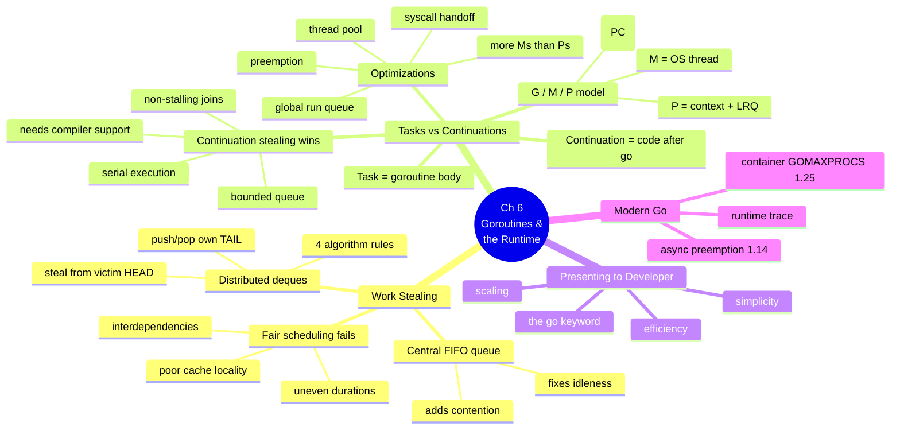
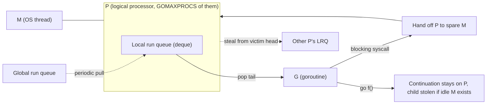

# Chapter 6 — Goroutines and the Go Runtime

> Book: *Concurrency in Go* (Katherine Cox-Buday, O'Reilly 2017) · Chapter 6 · Pages ~197–212
> ⬅️ Prev chapter: [Chapter 5 — Concurrency at Scale](../ch05-concurrency-at-scale/README.md) · ➡️ Next: [Appendix — Tooling & Diagnostics](../appendix-tooling-and-diagnostics/README.md) · 🏠 [Book index](../README.md)

## Overview

This final chapter lifts the hood on everything the earlier chapters took for granted: *how does the `go` keyword actually work?* Go multiplexes your goroutines onto a small pool of OS threads using a **work-stealing scheduler**. The chapter builds that scheduler from first principles — rejecting naive fair scheduling and a central FIFO queue in favor of **per-processor double-ended queues** where idle threads steal work from busy ones. It then sharpens the model: Go steals **continuations** (the code after a `go` call), not tasks, which bounds queue size and keeps joins non-stalling. Next comes the runtime's real vocabulary — **G** (goroutine), **M** (OS thread), **P** (context/processor) — plus the pragmatic optimizations the abstract model omits: a thread pool, a **global run queue**, **syscall handoff** of a P from a blocked M to a free one, and goroutine **preemption**. Finally it reminds us that all this sophistication is exposed through exactly one keyword: `go`. Modern Go has advanced the runtime considerably since 2017 — **async preemption (1.14)**, **container-aware GOMAXPROCS (1.25)**, and better **runtime/trace** tooling — which these notes fold in as "🆕 Modern Go" callouts.

## Chapter mind map

## Scheduler at a glance (G / M / P)

## Mini-chapters

| # | File | One-line summary |
|---|------|------------------|
| 6.1 | [01-work-stealing.md](01-work-stealing.md) | Why fair scheduling and central queues fail, and how per-processor deques with tail-push / head-steal balance fork-join work while preserving cache locality. |
| 6.2 | [02-stealing-tasks-or-continuations.md](02-stealing-tasks-or-continuations.md) | Continuation stealing vs task stealing; the real **G/M/P** model, local/global run queues, syscall P-handoff, and preemption (incl. Go 1.14 async preemption & Go 1.25 container-aware GOMAXPROCS). |
| 6.3 | [03-presenting-to-the-developer.md](03-presenting-to-the-developer.md) | All that machinery is exposed through a single keyword — `go` — delivering scaling, efficiency, and simplicity at once. Chapter & book conclusion. |

## Verified programs

All complete programs in this chapter were written to `/tmp/cig/verify/ch6/` and run with Go 1.27.2:

- `fib/` — recursive channel-per-goroutine Fibonacci (work-stealing demo) ✅
- `schedinfo/` — `NumCPU` / `GOMAXPROCS` / `NumGoroutine` + `GODEBUG=schedtrace` ✅
- `gmp/` — syscall/handoff demo on `GOMAXPROCS=1` ✅
- `preemption/` — async-preemption demo (tight loop + sibling goroutine) ✅
- `trace/` — `runtime/trace` producing `trace.out` for `go tool trace` ✅
- worker-pool fan-in (in 6.3) — verified sum of squares = 2870 ✅

> Note: `go run -race` could not be exercised in this environment because the race detector requires cgo and no C compiler is installed. The race detector is covered in depth in the [Appendix race-detection mini-chapter](../appendix-tooling-and-diagnostics/02-race-detection.md).
